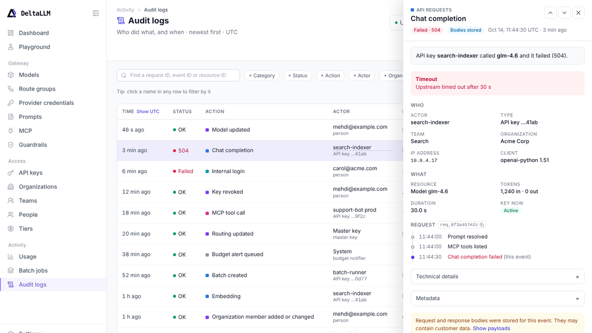

# Audit Logs

Audit Logs show who did what, and when: administrative changes, sign-ins, API requests, MCP tool
calls, spend report reads, and system events. The page uses the same layout and filters as the
Requests view of [Usage & Spend](usage.md).

**Access:** platform admin or `audit.read`; results remain limited to authorized tenant scope. See
[Access requirements](access-requirements.md), the [Audit API](../api/admin.md#audit), and [Audit
Log](../features/audit-log.md).

## The list

- **Time window:** 1h, 24h, 7d, 30d, or Custom in the page header. The default is the last 24 hours.
  A custom range takes a start and an end time in UTC.
- **Rows** read as plain words: the action ("Model updated", "Key revoked"), the actor's email or
  API key name, and the resource's name and type. A colored dot shows the event's category. An API
  key shows the last four characters of its hash in gray after its name.
- **Status** shows `OK`, the HTTP status code of a failed request, or `Failed`. Durations over
  10 seconds are red.
- **Time** is relative. **Show times in UTC** in the Columns menu switches the column to exact UTC
  times. The choice is saved in your browser.
- **Narrow screens:** the table hides Organization, Duration, and the extra columns first, then
  Resource. Long names end with "…". On a phone, or on a tablet with the menu open, each event
  shows as two lines: the action and time, then the actor and the resource. The event panel shows
  all values.
- **Load 50 more** adds the next older events. The page does not count every matching event, so
  it stays fast on large audit tables.
- **Refresh** reloads the list. Auto refresh can reload it every minute or every five minutes.

## Filters

The search box finds an event by request ID, event ID, or resource ID. The chips beside it filter by:

| Chip | Filters by |
| --- | --- |
| Category | Admin changes, Sign-ins & accounts, API requests, MCP tools, Spend reports read, or System & external auth |
| Status | Succeeded or failed |
| Action | One action from the full list, narrowed to the chosen category |
| Actor | A person or API key from the rows on screen, any email or key name you type, the master key, or the system |
| Organization | One of the organizations whose audit log you can read |
| Resource | One resource from the rows on screen, or any resource of one type |
| IP address | One client IP address |

Click a name, organization, or resource in a row to filter by it. The chips show this tip when you
hold the pointer on them. Click anywhere else on the row
to open the event. Filters and the open event are part of the page address, so you can share a
filtered view or one event.

The **Columns** icon in the top-right corner of the table adds Team, IP address, Tokens, Request
ID, and Client to the table. These columns show on wide screens only. The choice is
saved in your browser. Team comes from the event's API key. Client is read from the user agent,
such as "Chrome on macOS" or "openai-python 1.51".

## The event panel

The panel opens beside the list. Use ↑ and ↓ to move to the previous or next event, and Esc to
close it. From top to bottom it shows:

- a one-line summary, and the error when the event failed
- **Who:** the actor, their current role or key type, team, organization, IP address, and client
- **What:** the resource and its current state ("Active", "No longer exists", "Cancelled at 61%"),
  tokens and duration for requests, and the changed field names for admin changes
- **Request:** the other events of the same request, in order
- **Recent sign-ins by this person** for sign-in events
- **Same batch**, or the history of the resource, for events on a batch or another resource
- closed **Technical details** (IDs, action code, user agent) and **Metadata** sections

When request and response bodies were stored, the panel shows a "Bodies stored" or "Redacted"
badge. The bodies load only when you click **Show payloads**.

The buttons at the end of the panel open the request in Usage & Spend, open the resource's page,
and show the events from the same IP address. **Copy link** copies a link to the event.

## Export

**Export** downloads the events that match the current filters and time window, up to 10,000
events, as CSV or JSONL.

## Notes

- Admin changes record which fields changed, not the old and new values. The panel shows the new
  values only in the request body, when bodies were stored.
- A revoked API key is deleted, so its name and owner can no longer be shown. The panel shows
  "Revoked or deleted".
- Emails of people outside your organizations are hidden unless you are a platform admin.
- The panel's lookups and the related events load only when you open an event.
