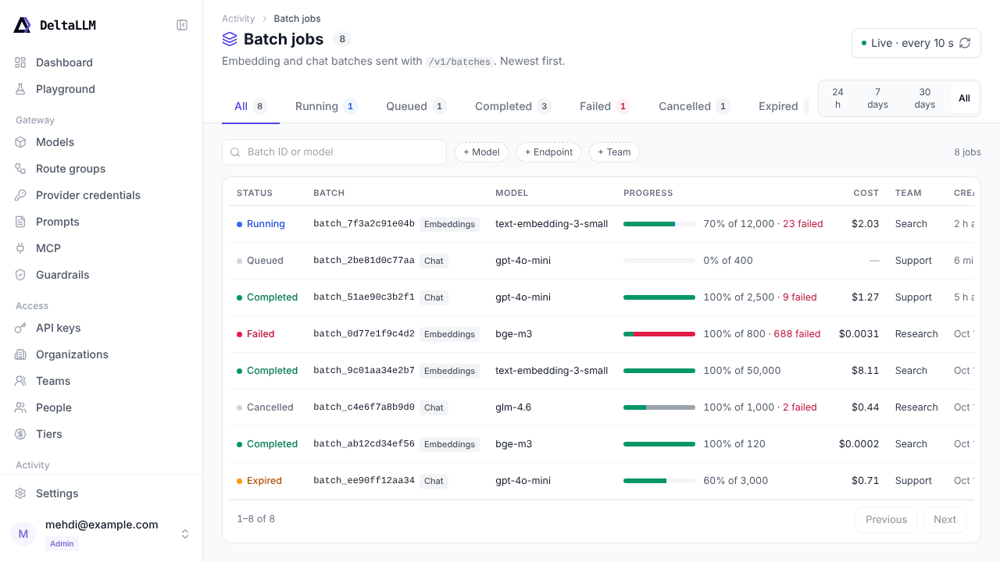

# Batch Jobs

Batch Jobs is the operations view for long-running asynchronous work.

--8<-- "videos/batch-jobs.html"

The public batch API supports embeddings and non-streaming chat completion batches. This page helps operators inspect job progress, failures, and cost after submission.

**Access:** every account with an organization or team membership can open this page. What the
page shows depends on the role. See [Who sees which batches](#who-sees-which-batches). Cancel,
retry, stale requeue, mark-failed, and webhook replay are enabled only when the caller has update
capability in the batch's organization/team scope. See [Access requirements](access-requirements.md),
the [Batch admin API](../api/admin.md#batches), and [Batch production setup](../features/batching.md).

## Who sees which batches

| Account | Batches on the page | Actions |
|---------|---------------------|---------|
| Platform administrator or master key | All batches | All actions |
| Role with `key.read` in an organization or team (for example organization owner or admin, billing, auditor, team admin, team developer) | All batches in that organization or team | Actions need `key.update` in the batch's scope |
| Other members (for example organization member or team viewer) | Only the batches that they created with their own API keys, in their current organizations and teams | None. The view is read-only |

For a member without `key.read`, the page says that it shows only your batches. The server applies
this filter to the list, the summary counts, the detail view, the items, the costs, and the webhook
delivery state. It does not use the page to decide.

A batch belongs to the account that owned the API key when the batch was created. These batches
have no owner, so they do not show in the member view:

- batches created before DeltaLLM recorded the key owner
- batches created with a service account key or a key without an owner

If you leave an organization or team, its batches no longer show in your member view.

The archived delivery-only view (see below) is for operators with `key.read` only.

Cloud customer sessions cannot open this page.

## Quick Success Workflow

1. Submit a batch through the API
2. Open **Operations > Batch Jobs**
3. Filter by status or search by batch ID
4. Open the batch detail to inspect progress and failures
5. Cancel the batch if needed

## What This Page Shows

- queue summary counts
- status-based filtering
- per-batch progress
- total and failed item counts
- team ownership
- estimated or accumulated cost
- timestamps for creation, start, and completion
- redacted terminal webhook delivery status, attempts, status class, and bounded failure reason
- a replay action for failed webhook deliveries when the operator has batch update permission
- an archived delivery-only view when ordinary batch metadata has already been cleaned up

## When To Use It

Use this page when work is not request-response interactive and you need:

- visibility into queued or running jobs
- failure review at the item level
- cancellation controls
- operational reporting after a batch finishes
- inspection or replay of a failed terminal webhook without exposing customer delivery material

A known batch ID can have no retained job metadata but still have retained webhook delivery state.
When you open its detail route, the page looks for this delivery state.
The page identifies the archived state. It shows only redacted delivery fields and permitted replay controls.
Job items, cost, cancellation, destination, headers, payload, and signing material are unavailable.

After **Replay delivery** succeeds, the page immediately shows the delivery as queued and refreshes only the webhook delivery state. If that follow-up refresh fails, a warning explains that the replay was scheduled but the newest status could not be loaded. The warning does not mean the replay failed; refresh the page to inspect its current state.

## Related API Surface

The admin backend exposes endpoints for:

- batch summary
- batch list
- batch detail with items
- batch cancellation
- redacted webhook delivery inspection
- failed-only webhook replay

The public data-plane API also exposes:

- `/v1/files`
- `/v1/batches`

See [Proxy Endpoints](../api/proxy.md) and [Admin Endpoints](../api/admin.md) for the API reference.

## Related Pages

- [Proxy Endpoints](../api/proxy.md)
- [Admin Endpoints](../api/admin.md)
