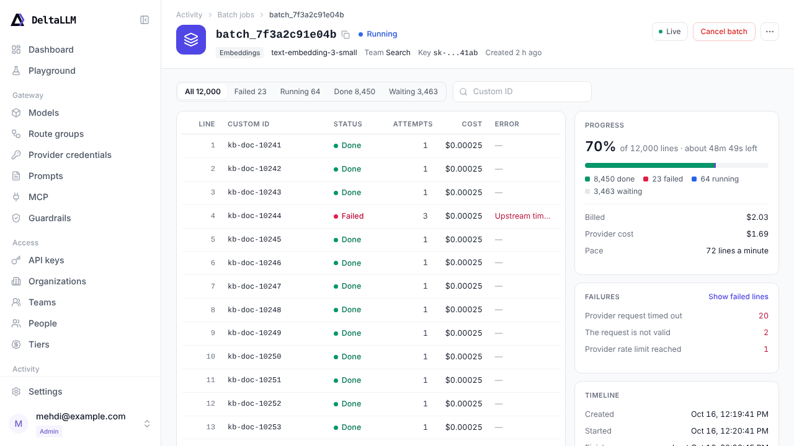

# Batch Jobs

Batch Jobs is the operations view for long-running asynchronous work.

--8<-- "videos/batch-jobs.html"

The public batch API supports embeddings and non-streaming chat completion batches. This page helps operators inspect job progress, failures, and cost after submission.

**Access:** every account with an organization or team membership can open this page. What the
page shows depends on the role. See [Who sees which batches](#who-sees-which-batches). Cancel,
retry, stale requeue, mark-failed, and webhook replay are enabled only when the caller has update
capability in the batch's organization/team scope. See [Access requirements](access-requirements.md),
the [Batch admin API](../api/admin.md#batches), and [Batch production setup](../features/batching.md).

## Who sees which batches

| Account | Batches on the page | Actions |
|---------|---------------------|---------|
| Platform administrator or master key | All batches | All actions |
| Role with `key.read` in an organization or team (for example organization owner or admin, billing, auditor, team admin, team developer) | All batches in that organization or team | Actions need `key.update` in the batch's scope |
| Other members (for example organization member or team viewer) | Only the batches that they created with their own API keys, in their current organizations and teams | None. The view is read-only |

For a member without `key.read`, the page says that it shows only your batches. The server applies
this filter to the list, the summary counts, the detail view, the items, the costs, and the webhook
delivery state. It does not use the page to decide.

A batch belongs to the account that owned the API key when the batch was created. These batches
have no owner, so they do not show in the member view:

- batches created before DeltaLLM recorded the key owner
- batches created with a service account key or a key without an owner

The member view uses your current memberships:

- As an organization member, you see your batches from all teams in that organization.
- If you leave an organization, your batches from it no longer show.
- If you leave a team but stay in its organization, you still see your batches from that team.

The archived delivery-only view (see below) is for operators with `key.read` only.

Cloud customer sessions cannot open this page.

## Quick Success Workflow

1. Send a batch through the API.
2. Open **Activity > Batch jobs**.
3. Select a status tab, a time window, or a filter to find the batch.
4. Click the row to open the batch.
5. Look at the progress and the failures in the right column.
6. Click a line to see its request, response, and error.

## The list

The list shows one batch on each row, newest first.

| Part | What it does |
|------|--------------|
| Status tabs | **All**, **Running**, **Queued**, **Completed**, **Failed**, **Cancelled**, and **Expired**. Each tab shows the number of batches for the filters that you set. **Running** includes batches that are finalizing. |
| Time window | Shows batches created in the last 24 hours, 7 days, or 30 days, or all batches. |
| Search | Finds a batch ID or a model name. |
| **Model**, **Endpoint**, **Team** | Filters the list. The model and team menus show the values that have batches, with the number of batches for each. They load only when you open them. |
| Progress | A bar with done (green), failed (red), and running (blue) lines. The text shows the percent of finished lines and the number of failed lines. |
| Duration | The run time. For a running batch, it also shows an estimate of the time left. This column shows on wide screens only. |
| **...** | Opens the batch, copies its ID, or cancels it. **Cancel batch** shows only for a running batch that you can change. |

The filters and the tab are in the page URL. You can share or bookmark a filtered list.

While a batch on the page runs, the page loads again every 10 seconds. The page does not load
when the browser tab is hidden. When no batch runs, you can set an automatic refresh, or click the
refresh button.

## The batch page

The header shows the batch ID, the status, the endpoint, the model, the team, the masked API key,
and the creation time. **Live** shows while the batch runs. The page then loads again every 10
seconds.

The header actions show only when they apply and you can change the batch:

- **Cancel batch** stops the batch after the lines that run now.
- **...** > **Retry finalization** writes the output files again. It shows when a batch is finalizing.
- **...** > **Requeue stale lines** puts lines with an expired worker lease back in the queue. It
  shows when a batch is running.
- **...** > **Mark as failed** marks all open lines as failed and stops the batch. You can give a
  reason.

Each action asks you to confirm. You cannot undo **Cancel batch** or **Mark as failed**.

### Lines

The table on the left shows the lines of the batch file, 25 lines on each page. Use the status
filter above the table to show **All**, **Failed**, **Running**, **Done**, or **Waiting** lines.
Each filter shows its number of lines. Type a custom ID to find one line. The ID must match fully.

Click a line to open its details at the side of the page. The panel shows the status, the attempts,
the cost, and the times. Its tabs show the stored request, response, error, and usage. A failed line
opens on the error. Use the arrow keys up and down to go to the previous or next line. Press Esc to
close the panel.

### Right column

The right column has the same height as the table.

| Card | What it shows |
|------|---------------|
| Progress | The percent of finished lines, the time left, the line counts, the billed cost, the provider cost, and the speed in lines each minute. |
| Failures | The failed lines in groups by error, with the number of lines in each group. **Show failed lines** filters the table. |
| Timeline | The creation, start, finish, and expiry times. For a running batch, it shows an estimate of the finish time. |
| Webhooks | The delivery state of each webhook event. **Replay** sends a failed event again. This card shows only when the batch has webhook events. |
| Files | The IDs of the input, output, and error files, with a copy button. |

The time left and the finish time are estimates. They use the average speed since the batch
started. They show after the batch runs for one minute and finishes five lines.

The failure groups use safe messages only. They never show the text from the provider.

## What This Page Shows

- status counts for each tab
- filters by status, time window, model, endpoint, and team
- the progress, the cost, and the time left of each batch
- the lines of a batch, with filters by status and custom ID
- failure groups by error
- redacted terminal webhook delivery status, attempts, status class, and bounded failure reason
- a replay action for failed webhook deliveries when the operator has batch update permission
- an archived delivery-only view when ordinary batch metadata has already been cleaned up

## When To Use It

Use this page when work is not request-response interactive and you need:

- visibility into queued or running jobs
- failure review at the item level
- cancellation controls
- operational reporting after a batch finishes
- inspection or replay of a failed terminal webhook without exposing customer delivery material

A known batch ID can have no retained job metadata but still have retained webhook delivery state.
When you open its detail route, the page looks for this delivery state.
The page identifies the archived state. It shows only redacted delivery fields and permitted replay controls.
Job items, cost, cancellation, destination, headers, payload, and signing material are unavailable.

After **Replay** succeeds, the page immediately shows the delivery as queued and refreshes only the webhook delivery state. If that follow-up refresh fails, a warning explains that the replay was scheduled but the newest status could not be loaded. The warning does not mean the replay failed; refresh the page to inspect its current state.

## Related API Surface

The admin backend exposes endpoints for:

- batch summary
- batch list
- filter values for the list (models and teams)
- batch detail with items
- failure groups of a batch
- batch cancellation
- redacted webhook delivery inspection
- failed-only webhook replay

The public data-plane API also exposes:

- `/v1/files`
- `/v1/batches`

See [Proxy Endpoints](../api/proxy.md) and [Admin Endpoints](../api/admin.md) for the API reference.

## Related Pages

- [Proxy Endpoints](../api/proxy.md)
- [Admin Endpoints](../api/admin.md)
