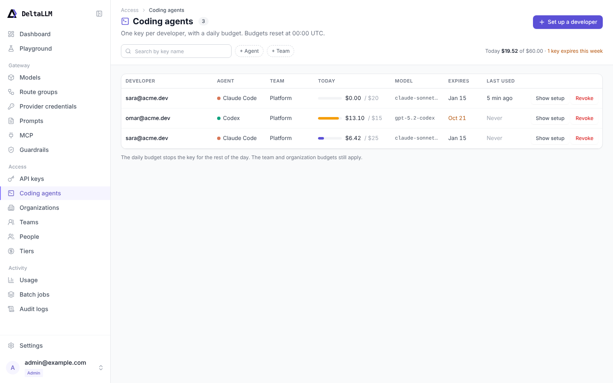

# Coding agents

The Coding agents page gives each developer a key for a coding agent, such as Claude Code, Codex or OpenCode. Each key has a daily budget, an expiry date and a setup text that the developer pastes into the agent.

**Access:** key administrators (`key.update`) see the admin view. Team members with `key.create_self` see the self-service view. See [Access requirements](access-requirements.md) and [API keys](api-keys.md).

## Set up a developer (admin view)

The admin view lists the coding-agent keys in your scope. Each row shows the developer, the agent, the team, the spend today, the main model, the expiry date and the last use.

To give a developer a key:

1. Click **Set up a developer**.
2. Select the team and the developer. The developer must be a member of the team.
3. Select the agent. The agent sets the default models and the setup text. The key works with all agents.
4. Click **Next**.
5. Set the daily budget and the expiry. Select the main model and, for Claude Code and OpenCode, the small model.
6. Click **Create key**.
7. Copy the setup text and send it to the developer. DeltaLLM shows the key only once.
8. Keep the drawer open. When the agent sends its first request, **Check the connection** changes to **Connected**.

The developer owns the key. The developer sees the key in **My keys** on the API keys page and on the Coding agents page, and can revoke it.

To see the setup text again, click **Show setup** on the row. The text then shows `YOUR_DELTALLM_KEY` in place of the key. To get a new key, regenerate the key on the [API keys](api-keys.md) page.

## Connect a coding agent (self-service view)

A team member who can create self-service keys sees **Connect a coding agent**:

1. Select the agent.
2. Select the team and the main model.
3. Set the daily budget and the expiry. The team self-service policy sets the maximum values.
4. Click **Create key**, then copy the setup text.

The **Your agent keys** list shows the coding-agent keys of the member, with the spend today, the expiry and the last use.

## Setup text

| Agent | What the setup text contains |
| --- | --- |
| Claude Code | `ANTHROPIC_BASE_URL`, `ANTHROPIC_AUTH_TOKEN`, `ANTHROPIC_MODEL` and `ANTHROPIC_DEFAULT_HAIKU_MODEL` for the shell profile. The same values are also available as `~/.claude/settings.json`. |
| Codex | A `deltallm` provider for `~/.codex/config.toml` that uses `<gateway>/v1` and the Responses API, and the `DELTALLM_API_KEY` variable. |
| OpenCode | A `deltallm` provider for `opencode.json` that uses `@ai-sdk/openai-compatible`, and the `DELTALLM_API_KEY` variable. |
| Other | The OpenAI-compatible and the Anthropic-compatible variables. |

The setup text uses the address of the admin UI as the gateway address.

## Daily budget

The key budget resets every day at 00:00 UTC. When the key spends its daily budget, the gateway refuses requests with that key until the next reset. The team and organization budgets also apply.

**Today** on the page shows the spend since the last reset. After 00:00 UTC, the page shows $0.00 before the next request resets the stored value.

!!! note
    For a self-service key, the team budget ceiling applies to each day. A member can also revoke a key and create a new one. Use team and organization budgets as the total limit.

    Keys that an admin creates for a developer count toward the self-service key limit of that developer in the team.

## Related API fields

The page uses the [API-key admin API](../api/admin.md#api-keys):

- `budget_duration` (for example `"1d"`) makes the key budget reset at each UTC period.
- `coding_agent` stores the agent and the default models.
- `GET /ui/api/keys?coding_agent=true` lists only coding-agent keys.
