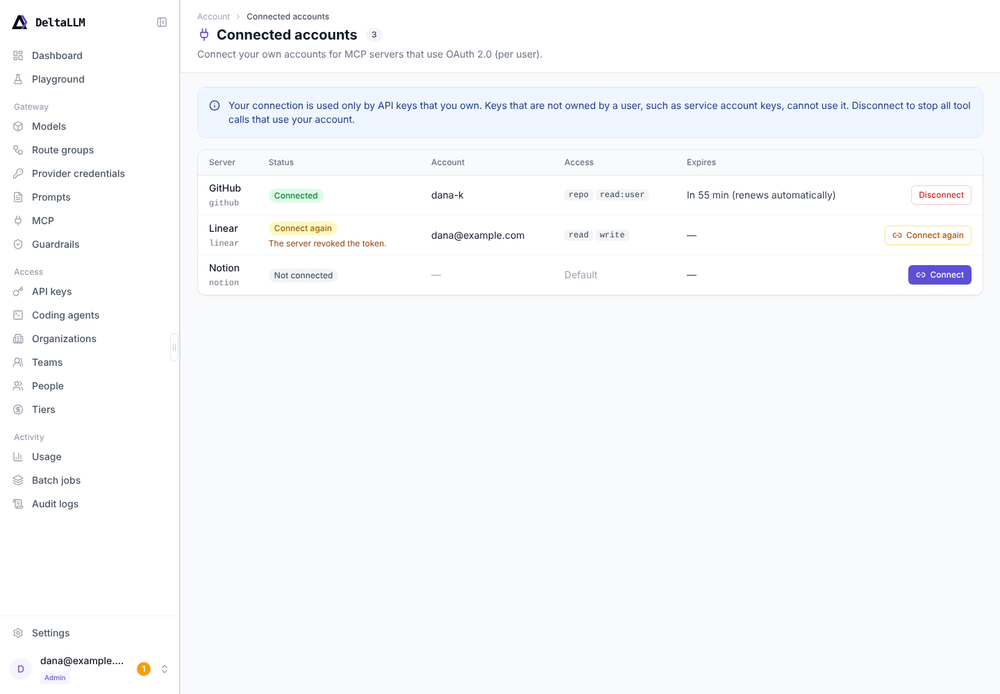

# Connected accounts

Use the Connected accounts page to connect your own accounts for MCP servers that use
OAuth 2.0 (per user). Tool calls from API keys that you own then act as you at the server.

To open the page, select your name at the bottom of the menu, then **Connected accounts**. A
number next to your name shows how many connections you must connect again.

**Access:** every signed-in user. You see the OAuth 2.0 (per user) servers that you can use,
and the servers that you already connected. The master key has no account and cannot connect.

## Columns

| Column | Content |
| --- | --- |
| Server | The name and the key of the MCP server |
| Status | **Connected**, **Not connected**, or **Connect again** with the reason |
| Account | The account name at the server, when the server gives it |
| Access | The scopes of the connection |
| Expires | When the access token expires. **Renews automatically** shows that the gateway can refresh it |

## Connect an account

1. Select **Connect** on the row of the server.
2. Sign in at the server and allow the access.
3. The browser comes back to the page. The page shows **Account connected** and marks the row.

If the page shows **Connection failed**, read the message and start again. The sign-in link
works one time and expires after 10 minutes. It works only for the account that started it.

A tool error can contain a link such as `https://gateway.example.com/ui/connect/github`. The
link opens this page for that server.

## Connect again

The status **Connect again** shows that the server does not accept the stored token any more,
for example because you revoked the access at the server. Select **Connect again** and sign in.

## Disconnect

Select **Disconnect**, then confirm. The gateway revokes the token at the server when the server
supports it (RFC 7009), then deletes the tokens. Tool calls from your keys to that server stop
until you connect again.

## Which keys use your connection

Your connection is used only by API keys that you own. A key that no user owns, such as a
service account key, cannot use it. Such a key gets the error `mcp_user_key_required`.

## Related pages

- [MCP](mcp.md)
- [MCP endpoints](../api/mcp.md#per-user-oauth-servers)
- [MCP OAuth settings](../configuration/general.md#mcp-oauth-settings)
