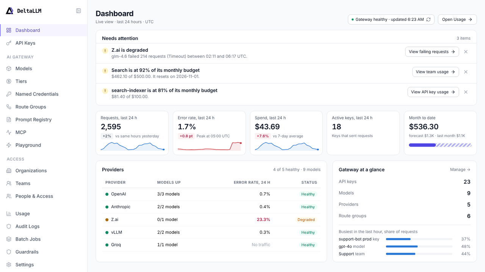

# Dashboard

The Dashboard is the landing page. It answers one question: is the gateway OK now?

**Access:** platform admin or a role with `spend.read`. The tiles and alerts follow the server's
authorized spend scope. See [Access requirements](access-requirements.md) and the [Spend admin
API](../api/admin.md#spend).

The Dashboard always shows the last 24 hours in UTC. It has no date picker and no large charts.
For a different period, a breakdown, or a filter, use [Usage & Spend](usage.md).
Each tile, alert, and row on the Dashboard opens the matching filtered view on the Usage page.

## Needs attention

This card shows problems that need an action. It shows these alerts:

- A provider is degraded or down.
- 10% or more of the requests to a provider failed in the last 24 hours (minimum 20 requests).
- The error rate is 5% or more and is at least two times the rate of the 24 hours before.
- Spend in the last 24 hours is 30% or more above the 7-day average.
- An organization, a team, or an API key used 80%, 90%, or 100% of its budget.

Critical alerts show first. Each alert has a link to the requests or the usage that caused it.

To hide an alert, click the **X** on the alert. The browser keeps the dismissal for 7 days for your account only.
If the problem gets worse, the alert shows again. For example, a budget that goes from 80% to 90% shows a new alert.
To see hidden alerts, click **Show N dismissed**. To show a hidden alert again, click **Restore**.
When no alert is open, the card shows "Nothing needs attention right now".

## Tiles

- **Requests, last 24 h**: compared with the same hours one day before.
- **Error rate, last 24 h**: compared with the 24 hours before. The note shows the hour with the most errors.
- **Spend, last 24 h**: compared with the average daily spend of the last 7 days.
- **Active keys, last 24 h**: the number of API keys that sent requests.
- **Month to date**: the spend of this month, a forecast for the full month, and the spend of last month.

## Providers

This table shows each provider with its healthy model count, its error rate in the last 24 hours, and its health status.
Click a provider to see its requests.

## Gateway at a glance

This card shows the number of API keys, models, providers, and route groups.
It also shows the API key, the model, and the team that sent the most requests in the last hour.

## Loading and refresh

Each card loads by itself and shows a skeleton until its data is ready. A slow card does not stop the other cards.
The page reloads its data one time each minute while the browser tab is visible.
To load the latest data immediately, click the status button at the top right.

The live reports use the reporting cache of the gateway. All users who open the Dashboard in the same minute
share one database read. Past days stay in the cache for 15 minutes. See [Usage & Spend](usage.md#database-load).
