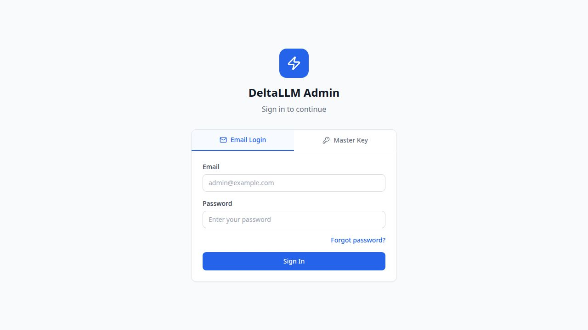

# Administer DeltaLLM

The Admin UI is where you manage models, access, spending, safety rules, and day-to-day activity.

## Open the Admin UI

- Docker quickstart: `http://localhost:4002`
- Local development: `http://localhost:5000`

You can sign in with an administrator email and password, a configured SSO provider, or the master
key during local setup. What you can see and change depends on your role. Read [Sign in and get
access](access-requirements.md) if a page or action is missing.

## Find the right area

The side menu has the same sections for all users. You see only the pages that your role can use.
If your role cannot use any page in a section, the menu does not show that section.

| Menu section | Page | What you do there |
| --- | --- | --- |
| Top | [Dashboard](dashboard.md) | Check what needs attention now |
| Top | [Playground](playground.md) | Test a model with a real key |
| Gateway | [Models](../guides/admin-models.md) | Connect provider-backed models |
| Gateway | [Route groups](../guides/admin-route-groups.md) | Control routing and failover across models |
| Gateway | [Provider credentials](../guides/admin-provider-credentials.md) | Reuse and rotate provider secrets |
| Gateway | [Prompts](prompt-registry.md) | Manage reusable, versioned prompts |
| Gateway | [MCP](mcp.md) | Connect external tools and approve protected tool calls |
| Gateway | [Guardrails](guardrails.md) | Check prompts and responses for risky content |
| Access | [API keys](api-keys.md) | Give applications controlled access |
| Access | [Organizations](organizations.md) and [teams](teams.md) | Set ownership, budgets, and limits |
| Access | [People](people-and-access.md) | Manage user accounts, roles, and membership |
| Access | [Tiers](../guides/admin-tiers.md) | Reuse model access, pricing, and limits across organizations |
| Activity | [Usage](usage.md) | Find cost and request trends. Users who can see only their own spend see **My usage**. |
| Activity | [Batch jobs](batch-jobs.md) | Monitor background jobs |
| Activity | [Audit logs](audit-logs.md) | Review important system changes |
| Bottom | [Settings](settings.md) | Change installation-wide defaults |

Select your account at the bottom of the menu to open the documentation or to sign out.

These pages are not in the menu:

- [Sign-in and access](access-requirements.md): resolve missing pages or blocked actions.
- [Budgets](../guides/admin-budgets.md) and [rate limits](../guides/admin-rate-limits.md): control
  spending and request volume. You set them on organizations, teams, and keys.

## Recommended first setup

1. Add one model and confirm that it is healthy. Enter the provider key directly for the simplest
   setup, or save a [provider credential](../guides/admin-provider-credentials.md) when several
   models will share it.
2. Create an organization and a team. Every application key belongs to a team.
3. Give the organization and team access to the model.
4. Create a key for the first application and copy it immediately.
5. Test the model in the Playground.
6. Add budgets, rate limits, routing, or guardrails as needed.

The Admin UI is not the security boundary by itself. The API checks permissions again for every
request.
