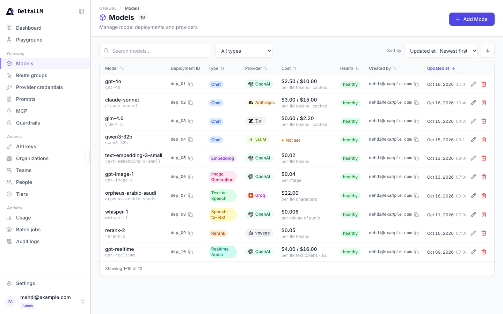
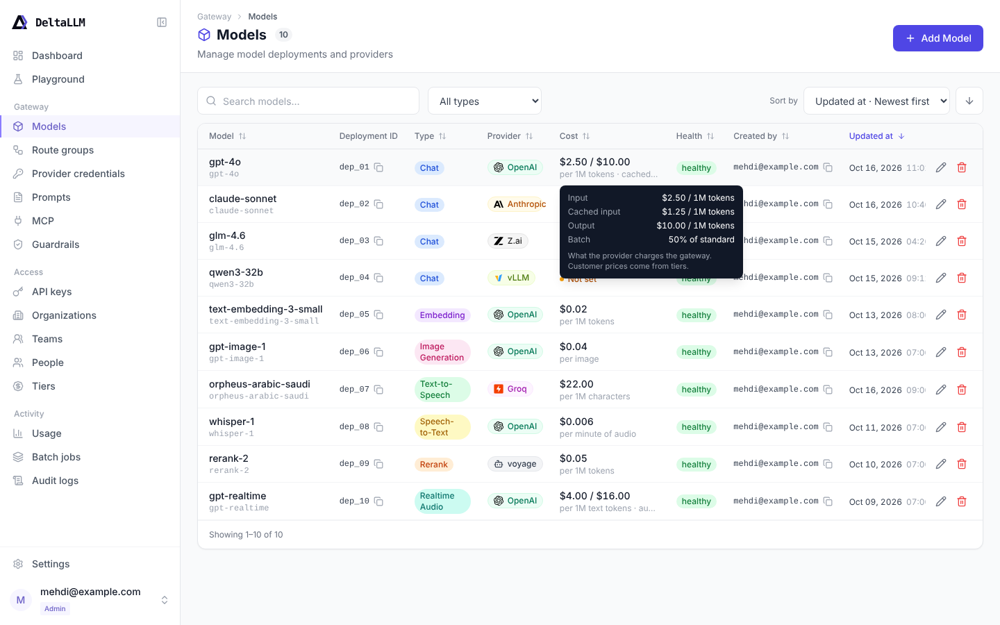
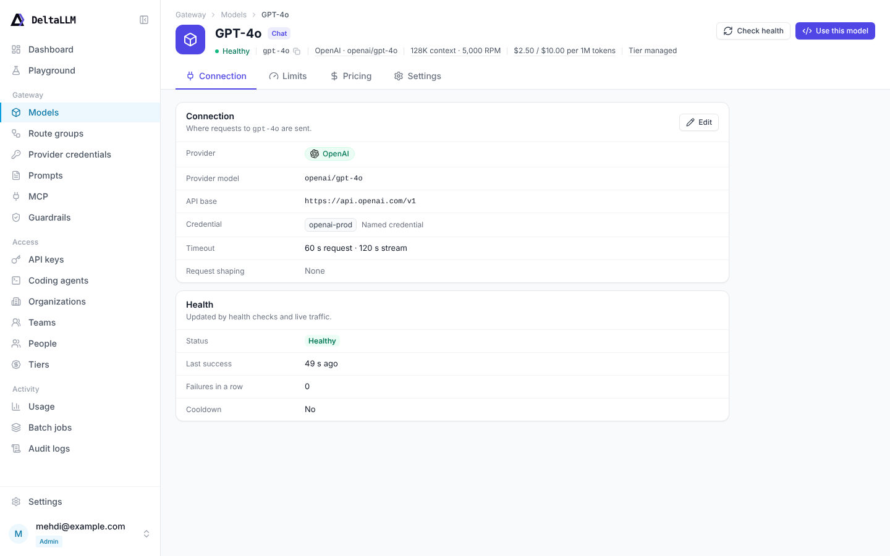
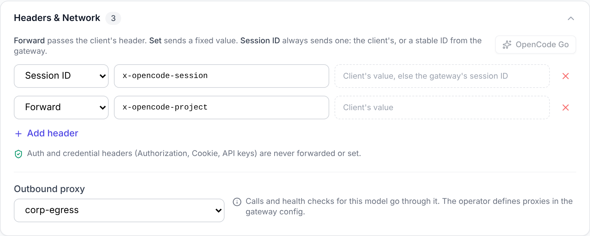

# Models

The Models page is where operators create and manage concrete provider-backed deployments.

Each deployment defines:

- the public model name clients will call
- the provider identity used for routing visibility, spend reports, callbacks, and dashboards
- the upstream provider model ID
- credentials and connection details, either inline or through a shared named credential
- the workload type, such as chat or embeddings
- optional pricing and default request parameters



**Access:** authenticated accounts see permitted models. Platform administrators manage deployments; eligible creator accounts, including [external customer sessions](../configuration/external-customer-auth.md), can create and manage their own private models and permitted workspace grants. External grants stay within the registered customer organization/team. See [Access requirements](access-requirements.md), [model deployment
configuration](../configuration/models.md), and [provider capabilities](../providers/capabilities.md).

## List controls

Models, Route groups, and Prompts use the same list controls.
Select a column heading or use **Sort list** to change the order.
The server sorts all permitted results before it selects a page.
The initial order is **Updated at**, newest first. Search resets the page.

**Created by** shows who created the item:

- An account: platform administrators and the creator see the creator email address. Other users see a short account ID.
  Select the copy control to copy the full account ID.
- **Master key**: an operator created the item with the master key. A master key has no account.
- **System**: DeltaLLM created the item, for example from configuration.
- **Deleted account**: the creator account was deleted after the item was created.
- **Not recorded**: the item was created before DeltaLLM recorded the creator.

Sort by **Created by** to order items by creator email address. Items without a visible email address appear last.
**Updated at** shows the stored update time in your local time zone.
If an old record has no update time, the cell shows **Not recorded**.
**Visibility** is the last data column. Edit and delete controls sit in a trailing actions column at the end of each row,
so the name column only shows the name and key. Open a row for the full detail page.
On small screens, each row becomes a card with the same fields and the actions in its header.

You can sort by name, type, provider, cost, health, creator ID, update time, or visibility.
The **Deployment ID** column has a copy control. The provider column uses the existing provider icons.
The type column uses the existing type pills.
Credential settings remain on the model detail and edit pages.
If health data is unavailable, the list shows **Unknown**.

### Cost column

The **Cost** column shows the price that the provider charges the gateway for each deployment.
It uses the prices that you set in the model pricing fields. It does not show tier prices for customers.
Customer prices come from [Tiers](tiers.md).

Each cell has two lines:

- The first line shows the main price. For a model with input and output prices, it shows both, for example `$2.50 / $10.00`.
- The second line shows the unit. For chat models, it also shows the cached input price, for example `per 1M tokens · cached $1.25`.
  If the second line is too long, the list cuts it short.

Hold the pointer on a cell, or move the keyboard focus to it, to see all the prices of the deployment.
This includes cached, batch, and audio prices.

The list converts the stored per-unit prices to these units:

| Model type | Stored price | Shown as |
| --- | --- | --- |
| Chat, embedding, rerank | `input_cost_per_token`, `output_cost_per_token` | per 1M tokens |
| Realtime | text and audio token prices | per 1M text tokens, with the audio prices on the second line |
| Text-to-speech | `input_cost_per_character`, then audio token, then second prices | per 1M characters |
| Speech-to-text | `input_cost_per_second` | per minute of audio |
| Image generation | `input_cost_per_image` | per image |

**Not set** shows when a deployment has no standard price. DeltaLLM records requests to this model at $0.
**Free** shows when you set the standard price to 0.

When you sort by **Cost**, token-priced models come first, in price order.
Models with other units come next, in groups by type and unit, so that the list does not compare a price per image with a price per token.
Models without a standard price are always last.



## Model Detail Page

Open a model from the list to see its detail page. It uses the same layout as the [route group](route-groups.md) page.

The line under the name shows the model's health, the model name clients send (with a copy button), the provider and provider model, the context window and RPM limit, the price, and how the model is shared. Click any part to open the tab that holds it.

- **Connection**: provider, provider model, API base, credential, timeouts, [request shaping](../configuration/request-shaping.md) rules, and health. When the model is unhealthy, the last error and its time appear here.
- **Limits**: context and output token caps, requests and tokens per minute, weight, priority, tags, access groups, default parameters, and batch worker settings. Realtime models also show how sessions run and are measured.
- **Pricing**: every stored price in the units people compare, such as per 1M tokens, per minute of audio, or per image, next to the stored per-unit value.
- **Settings**: names and identifiers, sharing, credential revoke, and delete. **Edit model** opens the full editor.

**Check health** runs a health check now. **Use this model** opens example requests in cURL, Python and JavaScript, with links to the Playground and to API keys.
Each tab loads when you first open it.



## Quick Success Workflow

1. Open **Gateway > Models**
2. Add one deployment for a model you already have provider access to
3. Confirm the deployment becomes healthy
4. Verify the model appears in `GET /v1/models`
5. Send a test proxy request

## What You Manage Here

- `model_name`: the public name clients use
- `deployment_id`: the stable internal identifier for this deployment
- provider settings in `deltallm_params`
- workload mode in `model_info.mode`
- access groups in `model_info.access_groups`
- pricing metadata for spend tracking
- default request parameters

## Recommended First Deployment

For a simple first deployment:

1. Set `model_name` to the public name you want clients to use
2. Choose the provider
3. Set `deltallm_params.model` to the upstream model ID
4. Add the provider API key inline, or select a shared named credential
5. Keep the default mode as `chat` unless this is an embeddings, image, audio, or rerank model

If you do not set a `deployment_id`, DeltaLLM creates one automatically.

## ElevenLabs Audio Deployments

ElevenLabs deployments use the same public DeltaLLM audio routes as other providers, but DeltaLLM calls the native ElevenLabs upstream APIs behind the scenes.

For shared credentials and key rotation, create an ElevenLabs [Named Credential](named-credentials.md) with provider `elevenlabs`, the ElevenLabs API key, and the default API base `https://api.elevenlabs.io/v1`. Inline credentials also work for deployment-specific keys.

### Text-to-Speech

1. Open **Gateway > Models**
2. Choose **Text-to-Speech**
3. Set the public model name, for example `elevenlabs-tts`
4. Choose provider **ElevenLabs**
5. Set provider model to `eleven_multilingual_v2`, `eleven_v3`, or another ElevenLabs TTS model
6. Select the ElevenLabs named credential, or choose **Inline Credentials** and enter the API key and API base
7. Add default parameter `voice_id` when clients will not send a `voice` value
8. Optionally add default parameter `output_format`, for example `mp3_44100_128`
9. Save the deployment

If the public request includes `voice`, that value is used as the ElevenLabs voice ID. If the public request omits `voice`, DeltaLLM uses `model_info.default_params.voice_id`. A TTS deployment without either value returns a request error instead of making an upstream call.

### Speech-to-Text

1. Open **Gateway > Models**
2. Choose **Speech-to-Text**
3. Set the public model name, for example `elevenlabs-stt`
4. Choose provider **ElevenLabs**
5. Set provider model to `scribe_v2` or `scribe_v1`
6. Select the ElevenLabs named credential, or choose **Inline Credentials** and enter the API key and API base
7. Optionally add safe default parameters such as `language_code`, `timestamps_granularity`, `diarize`, `num_speakers`, or `tag_audio_events`
8. Save the deployment

DeltaLLM maps public transcription fields such as `language` and `temperature` to the native ElevenLabs multipart fields. It does not send OpenAI-only fields such as `prompt` or `response_format` upstream to ElevenLabs.

### ElevenLabs Default Parameters

| Key | Mode | Use |
|-----|------|-----|
| `voice_id` | TTS | Fallback voice ID when the public request omits `voice` |
| `output_format` | TTS | Native ElevenLabs output format such as `mp3_44100_128` |
| `language_code` | STT | Default transcription language when the public request omits `language` |
| `timestamps_granularity` | STT | Word or character timestamp granularity, when supported by the upstream model |
| `diarize` | STT | Enables speaker diarization |
| `num_speakers` | STT | Expected number of speakers for diarization |
| `tag_audio_events` | STT | Controls audio-event tags in transcription results |

### Troubleshooting

- Missing voice ID: add `model_info.default_params.voice_id` or require clients to send `voice`
- Auth failures: verify the named credential has `provider: elevenlabs`, a valid `api_key`, and no custom OpenAI auth fields
- Output format errors: use public `response_format` values such as `mp3`, `opus`, `wav`, or `pcm`, or configure a valid ElevenLabs `output_format` default
- STT duration billing: DeltaLLM derives billable duration from ElevenLabs timing metadata, then applies `input_cost_per_second` when configured

## Chat Batch Execution

For chat deployments, the model form includes **Batch Execution** controls in
the Chat Settings section.

Most deployments should use the default behavior and leave numeric fields blank.
Only set explicit limits when you know the provider or serving cluster capacity
you want DeltaLLM to reserve for batch work.

| Option | Stored as | What it does | Recommendation |
|--------|-----------|--------------|----------------|
| **Mode: Default concurrent** | No `deltallm_params.chat_batching` override | Sends one ordinary upstream request per batch item, bounded by the worker defaults. | Use this for most chat deployments, including vLLM and OpenAI-compatible providers with their own serving-side batching. |
| **Mode: Concurrent** | `deltallm_params.chat_batching.mode: concurrent` | Keeps one upstream request per batch item, but persists deployment-specific chat batching settings such as **Max In-Flight**. | Use when this deployment needs a tighter or higher per-worker cap than the global worker setting. |
| **Mode: Sync microbatch** | `deltallm_params.chat_batching.mode: sync_microbatch` | Groups compatible chat items into one synchronous upstream provider call when a matching executor is available. | Use only for provider adapters that are proven to return one result and exact usage per input item. Start with small batches such as `4` or `8`. |
| **Mode: Disabled** | `deltallm_params.chat_batching.mode: disabled` | Prevents chat microbatch grouping for this deployment. | Use for providers or models where batch behavior is unknown, unsafe, or hard to bill correctly. |
| **Max In-Flight** | `deltallm_params.chat_batching.max_in_flight` | Limits concurrent upstream chat requests for this deployment per worker replica. | Leave blank unless you need an explicit cap. Size it against provider limits, worker replica count, and serving capacity. |
| **Upstream Max Size** | `deltallm_params.chat_batching.upstream_max_batch_size` | Maximum number of chat items in one sync microbatch. Required for **Sync microbatch** and must be at least `2`. | Set only with **Sync microbatch**. Start at `4` or `8`, then increase only after latency, response shape, and usage accounting look correct. |
| **Max Total Input Tokens** | `deltallm_params.chat_batching.max_total_input_tokens` | Caps the combined input tokens in a sync microbatch chunk. | Set a conservative cap for sync microbatch providers so one large group does not exceed context or latency limits. Leave blank for concurrent modes. |
| **Scheduler Max In-Flight** | `model_info.batch_capacity.max_in_flight` | Sets the batch scheduler capacity slots this model group can have in flight. This is separate from live request routing. | Leave blank to use scheduler defaults or inferred capacity. Set it when a model group needs a hard batch-specific cap. |
| **Scheduler Max Claim Work Units** | `model_info.batch_capacity.max_claim_work_units` | Caps how much work the scheduler may claim for this model group at once. | Leave blank initially. Lower it when large jobs monopolize workers; raise it only after the model drains backlog without hurting latency. |
| **Capacity Fraction** | `model_info.batch_capacity.capacity_fraction` | Fraction of router `max_in_flight` to use when scheduler capacity is inferred from chat batching limits. Must be greater than `0` and no more than `1`. | Leave blank unless you are sharing the deployment between live traffic and batch work. Use a conservative value such as `0.25` for shared capacity; reserve `1` for batch-dedicated capacity. |

Blank numeric fields are treated as unset. For example, leaving **Max
In-Flight** empty does not send `0`; it leaves that limit to the worker default.
When **Mode** is **Default concurrent** and all chat batching numeric fields are
empty, the UI clears any stored `deltallm_params.chat_batching` override. If
**Max In-Flight** is set while Mode remains **Default concurrent**, the UI saves
an explicit `mode: concurrent` override with that limit. **Disabled** ignores
numeric batching fields. If **Sync microbatch** is selected, **Upstream Max
Size** is required and must be at least `2`.

## Access Groups

The model form has an **Access Groups** field for authorization groups.
An access group lets a scope grant access to a set of callable targets.
This removes the need to select each model separately.
To use this function, enter group keys such as `beta` or `support`.

Access groups are attached to the public model name, not a single provider deployment. If several deployments share the same `model_name`, keep their access group lists identical so group expansion remains deterministic.

Do not use access groups for routing.
Deployment tags are routing metadata. Requests can match them with `metadata.tags`.
Tags do not give an organization, team, key, or user access to a model.

## What the Table Tells You

- **Model Name**: the public runtime model name
- **Provider**: explicit deployment provider such as OpenAI or Groq
- **Type**: runtime mode such as `chat` or `embedding`
- **Deployment ID**: the internal ID used by route groups and policies
- **Health**: whether the runtime currently sees the deployment as healthy

## When You Need Route Groups

You do not need a route group for a single deployment.

Create a route group when:

- you want multiple deployments behind one logical target
- you want explicit routing policy
- you want controlled failover behavior
- you want to bind prompt behavior at the route-group level

## Custom Upstream Auth Headers

For these OpenAI-compatible providers, the model form supports inline upstream auth-header overrides:

- `openai`
- `openrouter`
- `groq`
- `together`
- `fireworks`
- `deepinfra`
- `perplexity`
- `vllm`
- `lmstudio`
- `ollama`

In the model form:

1. Choose **Inline credentials**
2. Enter `api_key` and any `api_base`
3. Expand the provider connection fields
4. Fill `Auth Header Name` and `Auth Header Format` if the upstream does not accept `Authorization: Bearer ...`

Example inline deployment payload:

```json
{
  "model_name": "support-vllm",
  "deltallm_params": {
    "provider": "vllm",
    "model": "vllm/meta-llama/Llama-3.1-8B-Instruct",
    "api_key": "gateway-key",
    "api_base": "https://vllm.example/v1",
    "auth_header_name": "X-API-Key",
    "auth_header_format": "{api_key}"
  },
  "model_info": {
    "mode": "chat"
  }
}
```

For shared gateway credentials, [Provider credentials](named-credentials.md) remain the recommended workflow. If a deployment references a named credential and also carries overlapping connection fields locally, the named credential values win.

## Parameters, Headers and Network

The model form has two cards that change what DeltaLLM sends to the provider. A number next to the card title shows how many rules are set.

**Parameters** has one row per body field:

- **Default** fills a value the client left out (`model_info.default_params`).
- **Override** always sends this value (`override_params`). Object values are merged.
- **Drop** removes the field before the call (`drop_params`).

Values keep their JSON type: `0.2` is a number, `true` a boolean and `{"enable_thinking": false}` an object. Override and Drop are available for chat models only.

**Headers & Network** (named **Network** for non-chat models):

- **Session ID** always sends the header: the client's value, or a stable ID for the conversation from the gateway.
- **Forward** copies the header from the client request when present.
- **Set** sends a fixed value.
- **OpenCode Go** adds an `x-opencode-session` Session ID row.
- **Outbound proxy** picks one of the proxies the operator defined in `general_settings.upstream_proxies`. Calls and health checks for this model then go through it.

Auth and credential headers (Authorization, Cookie, API keys) are rejected when you save. See [Request shaping](../configuration/request-shaping.md) for all rules.



## Operational Notes

- DeltaLLM validates provider and mode compatibility when you create or update a deployment
- The explicit provider is the source of truth for dashboards, spend reports, callbacks, and metrics
- Shared provider credentials are best managed through [Provider credentials](named-credentials.md)
- Creating, updating, and deleting deployments requires admin access
- Readable deployment IDs make later route-group work easier
- Visibility to organizations, teams, keys, and users is governed through callable-target bindings, access-group bindings, and scope policies

## Related Pages

- [Request shaping](../configuration/request-shaping.md)
- [Provider credentials](named-credentials.md)
- [Route Groups](route-groups.md)
- [Model Deployments config reference](../configuration/models.md)
- [Send your first request](../getting-started/quickstart.md)
