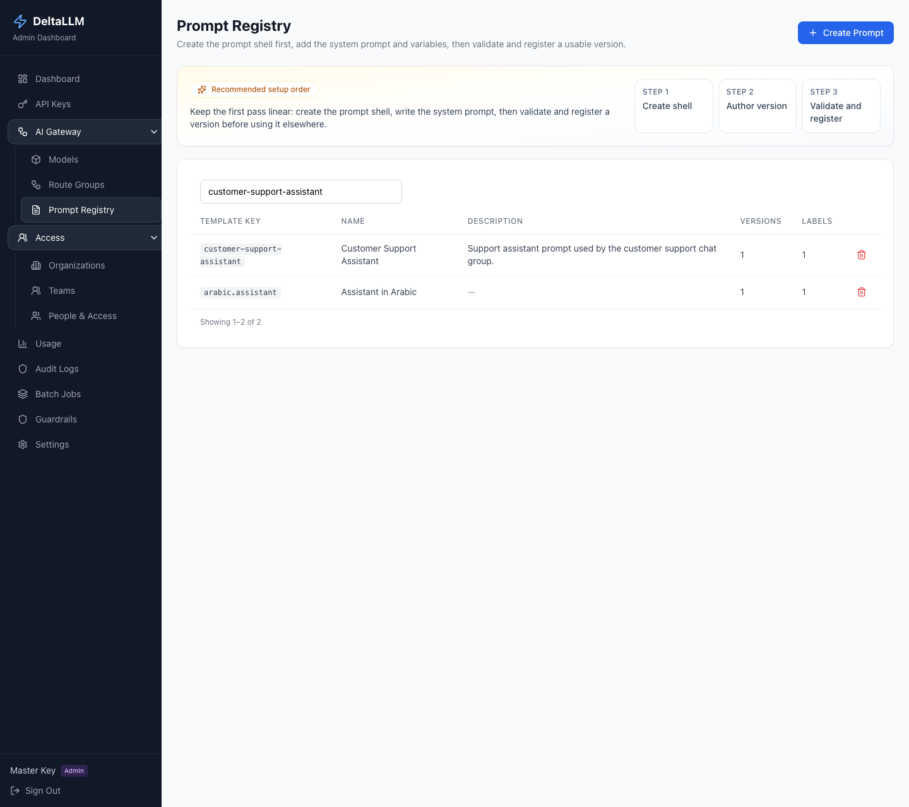
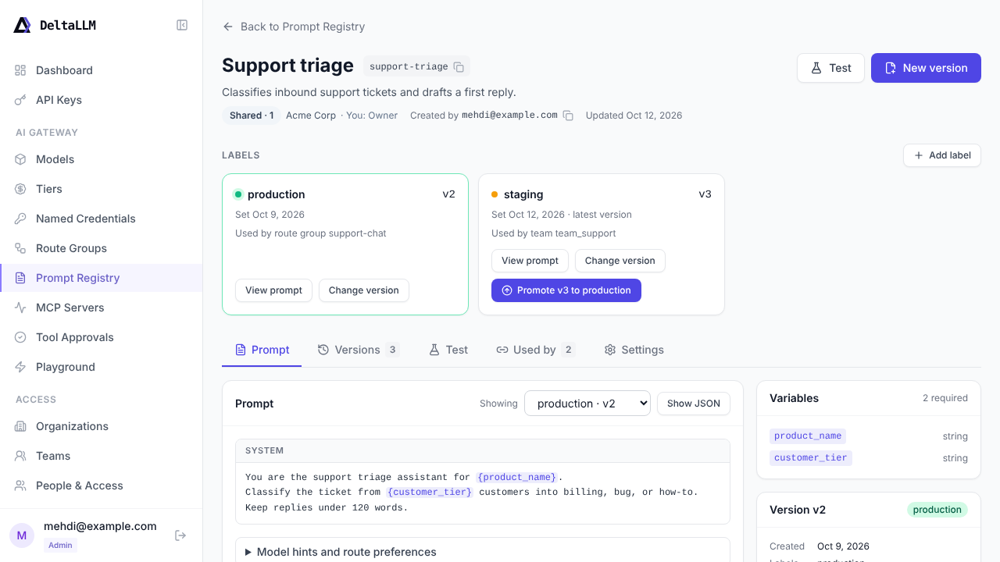

# Prompt Registry

Prompt Registry manages prompts as versioned runtime assets. To open it, select **Gateway > Prompts**.

Use it when you want prompts to be treated like managed configuration instead of hardcoded strings in applications.

**Access:** platform admin. Templates, versions, labels, tests, and bindings are control-plane
configuration. See [Access requirements](access-requirements.md) and the [Prompt Registry admin
API](../api/admin.md#prompt-registry).

## List controls

Models, Route groups, and Prompts use the same list controls.
Select a column heading or use **Sort list** to change the order.
The server sorts all permitted results before it selects a page.
The initial order is **Updated at**, newest first. Search resets the page.

**Created by** shows who created the item:

- An account: platform administrators and the creator see the creator email address. Other users see a short account ID.
  Select the copy control to copy the full account ID.
- **Master key**: an operator created the item with the master key. A master key has no account.
- **System**: DeltaLLM created the item, for example from configuration.
- **Deleted account**: the creator account was deleted after the item was created.
- **Not recorded**: the item was created before DeltaLLM recorded the creator.

Sort by **Created by** to order items by creator email address. Items without a visible email address appear last.
**Updated at** shows the stored update time in your local time zone.
If an old record has no update time, the cell shows **Not recorded**.
**Visibility** is the last data column. Edit and delete controls sit in a trailing actions column at the end of each row,
so the name column only shows the name and key. Open a row for the full detail page.
On small screens, each row becomes a card with the same fields and the actions in its header.

You can sort by name, version count, label count, binding count, creator ID, update time, or visibility.
Counts come from the stored template records. The **Description** column shows the first part of the description;
hover over it to read the rest.

## Quick Success Workflow

1. Create a prompt template.
2. Open the template and select **New version**. Write the prompt with `{variable}` placeholders.
3. Select **Test** and render the version with sample values.
4. Point the `production` label at the version.
5. Bind the prompt from a consuming surface, for example a route group.

## Template Detail Page

The detail page shows the prompt that requests get now. The page has these parts:

- **Header**: the name, the template key with a copy control, the description, the sharing summary,
  the creator, and the update date. Select **Test** or **New version** from the header.
- **Labels**: one card for each label. A card shows the version that the label points to and the date
  when the label moved. Platform administrators also see the bindings that use the label.
  Select **Change version** to point the label at a different version, or to remove the label.
  A label other than `production` shows **Promote to production** when it points to a different version.
- **Setup steps**: if the template has no `production` label, the page shows the steps to write a version
  and to point `production` at it. The steps go away when `production` exists.

The page has five tabs:

| Tab | What it shows |
| --- | --- |
| **Prompt** | The messages of the version that a label or version points to. Placeholders are highlighted. Select **Show JSON** to see the stored template body. The tab also lists the variables, the model hints, and the route preferences. |
| **Versions** | All versions with their labels and creation dates. Select a version to read it. Select a version in **Compare with** to see the added and removed words. |
| **Test** | A dry-run render. Select a label or a version, then enter one value for each variable. Select **Edit as JSON** to enter the variables as one JSON object. The result shows the rendered messages. |
| **Used by** | The bindings that use this template, with the label and the version that each binding gets. This tab is for platform administrators. A binding that names a missing label shows a warning, because requests skip that binding. |
| **Settings** | The name, the description, sharing and access, legacy metadata for platform administrators, and **Delete prompt**. |

Only platform administrators see **Used by**. Users without write access to the prompt do not see the controls that change it.

### Write a New Version

**New version** opens an editor that starts from the latest version. **New version from vN** on the
**Versions** tab starts from a different version. A saved version cannot change.

- Edit each message and its role, add a message, or remove a message.
- Select **Edit as JSON** to edit the full template body. Use JSON for a body that has a custom shape,
  for example message content parts.
- The editor finds the `{variable}` placeholders in the prompt. Every placeholder becomes a required
  variable. The editor keeps the type and other settings of a variable that the earlier version declared.
- Use `{{` and `}}` for literal braces.
- **After saving, point** moves a label to the new version when you save it. The default is `staging`
  when that label exists. The editor does not move an existing `production` label. Use
  **Promote to production** for that change, so that you can review it first.

### Move a Label

Before a label moves, the page shows the words that change between the two versions and the bindings
that get the new version on their next request. It also shows the variables that the new version
requires and the old version does not require. Requests that do not send these variables fail to render.

When you move `production` or `prod`, you can enter a name in **Approved by**. The audit log records
this name with the change.

### Published Status

Labels decide which version a request gets. The API still records a published status for each version,
but this status does not change the version that requests get. For this reason, the detail page does
not show the published status.

## What the Registry Owns

The registry owns:

- prompt identity through `template_key`
- immutable prompt versions
- stable labels such as `production`
- render and resolution testing
- binding records at supported scopes

## What the Registry Does Not Own

The registry defines the prompt itself, but it does not decide live traffic on its own.

In practice:

- Prompt Registry defines the prompt
- Route Groups or other supported scopes decide where it applies

## Why Versions and Labels Both Exist

- a version is immutable and good for review
- a label is movable and good for rollout

This gives operators a stable promotion flow:

1. Create a new version.
2. Test it.
3. Move a label such as `production` to it.
4. The bound consumer gets the new version on its next request.

## Validation and Safety

The prompt registry validates template keys and rejects secret-like content in template bodies before they are saved.

It also supports:

- render previews
- resolution previews
- binding inspection

## Related API Surface

The backend exposes endpoints for:

- templates
- versions
- labels
- bindings
- render preview
- resolution preview

See [Admin Endpoints](../api/admin.md) for the prompt-registry API reference.

## Related Pages

- [Route Groups](route-groups.md)
- [Admin API reference](../api/admin.md)
