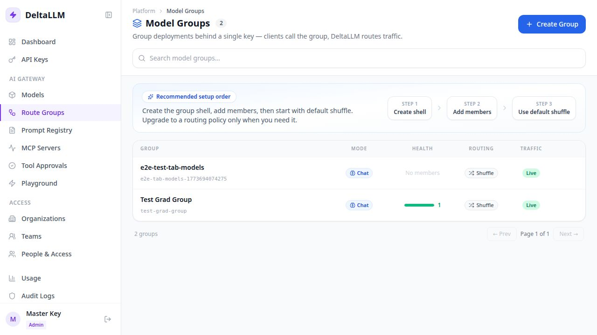
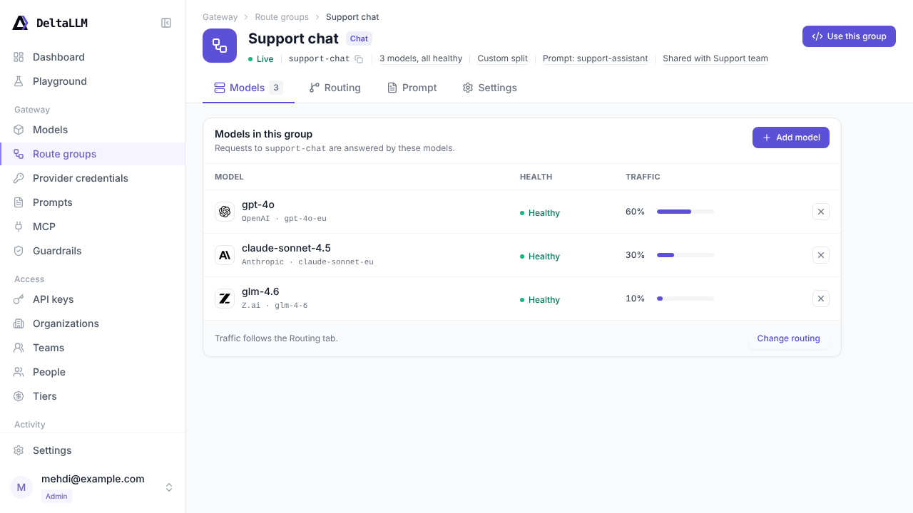
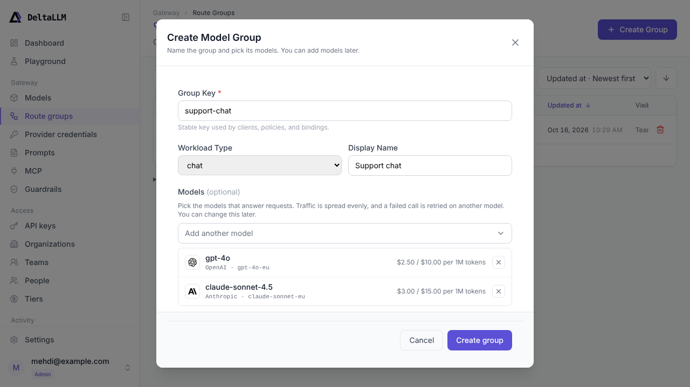
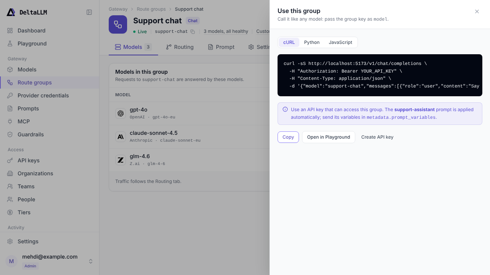
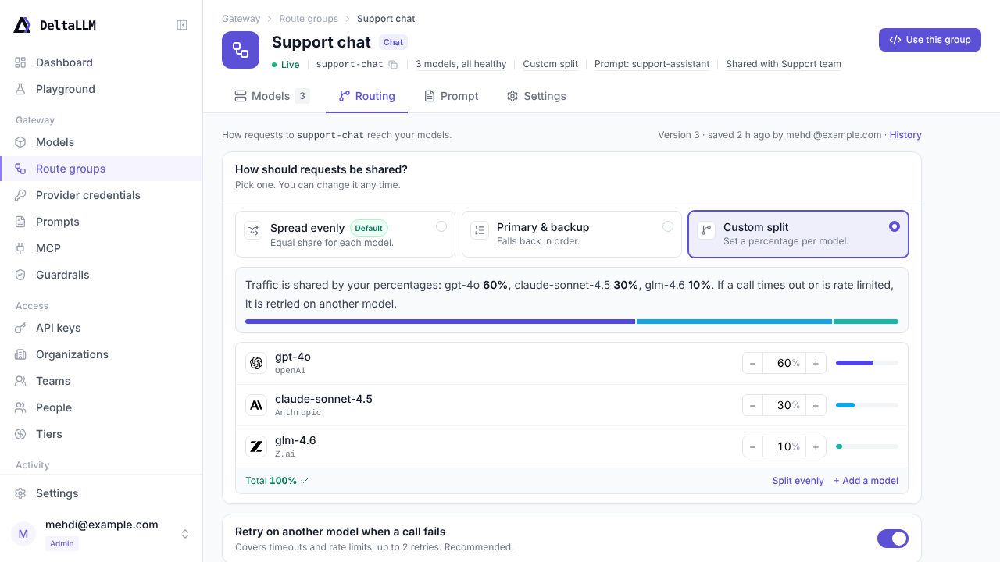
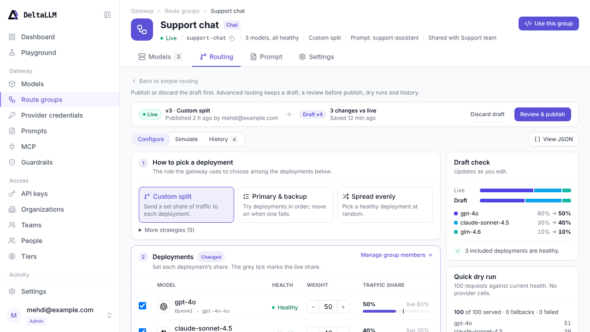
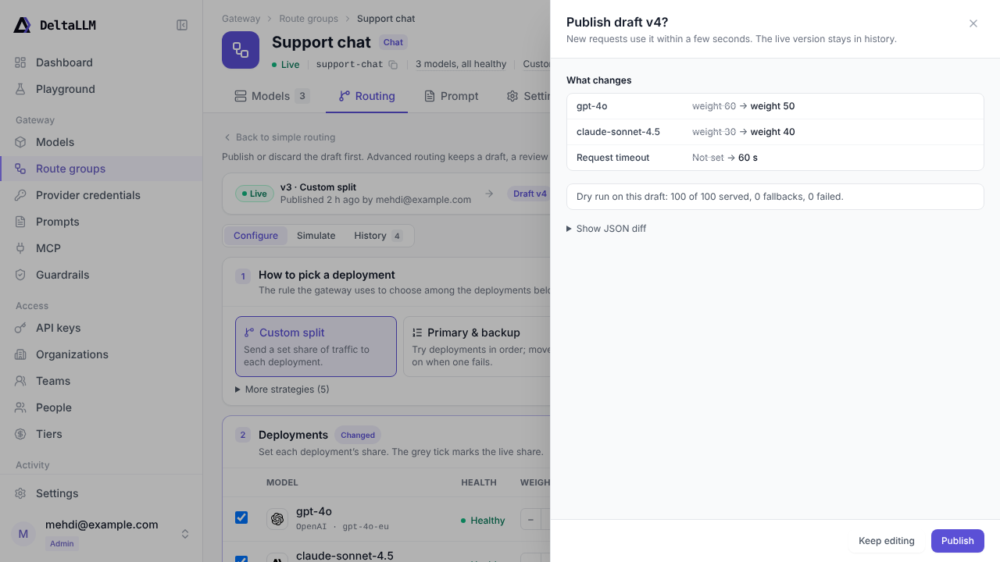
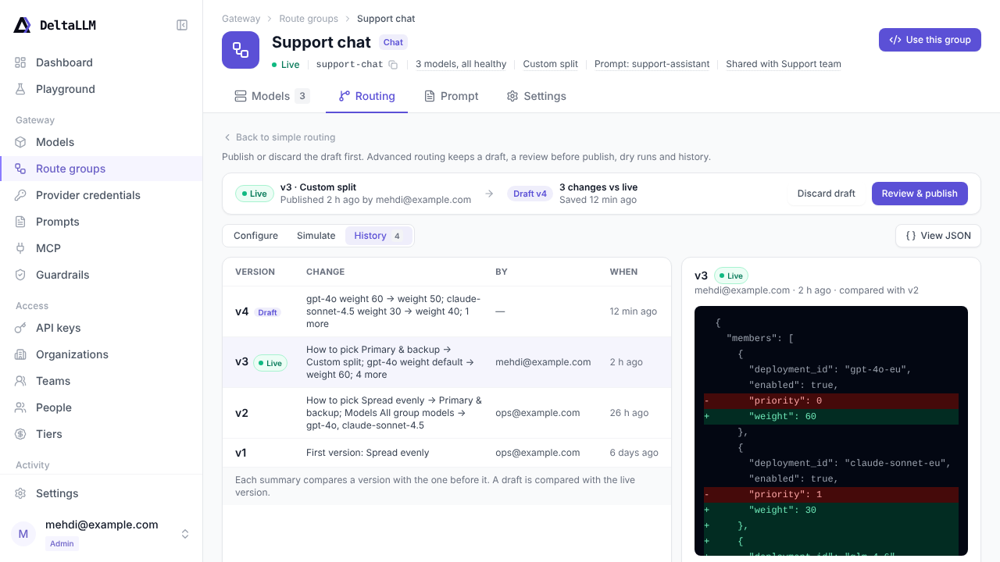

# Route Groups

Route Groups let you place multiple deployments behind one stable runtime target.

Use a route group when one public model name should:

- balance across several deployments
- fail over in a controlled way
- carry its own routing policy
- bind to a prompt at the group level





**Access:** platform admin for group, membership, policy, publication, simulation, and prompt-binding
operations. See [Access requirements](access-requirements.md), the [route-group API](../api/admin.md#route-groups),
and [Routing and Failover](../features/routing.md).

## List controls

Models, Route groups, and Prompts use the same list controls.
Select a column heading or use **Sort list** to change the order.
The server sorts all permitted results before it selects a page.
The initial order is **Updated at**, newest first. Search resets the page.

**Created by** shows who created the item:

- An account: platform administrators and the creator see the creator email address. Other users see a short account ID.
  Select the copy control to copy the full account ID.
- **Master key**: an operator created the item with the master key. A master key has no account.
- **System**: DeltaLLM created the item, for example from configuration.
- **Deleted account**: the creator account was deleted after the item was created.
- **Not recorded**: the item was created before DeltaLLM recorded the creator.

Sort by **Created by** to order items by creator email address. Items without a visible email address appear last.
**Updated at** shows the stored update time in your local time zone.
If an old record has no update time, the cell shows **Not recorded**.
**Visibility** is the last data column. Edit and delete controls sit in a trailing actions column at the end of each row,
so the name column only shows the name and key. Open a row for the full detail page.
On small screens, each row becomes a card with the same fields and the actions in its header.

You can sort by name, routing strategy, member count, health, creator ID, update time, or visibility.
Health includes enabled members and current cooldowns.
A group with some available members shows **Degraded**.
A disabled group shows **Paused**. A group with no enabled members shows **No active members**.
If health data is unavailable, the list shows **Unknown**.

## Quick Success Workflow

1. Select **Create Group**.
2. Enter the group key and the workload type.
3. Optional: in **Models**, select one or more models.
4. Select **Create group**.
5. On the group page, select **Use this group**. Copy a sample request, or open the group in the Playground.

When you select models in the create dialog, DeltaLLM adds them to the group.
It then publishes the default routing: traffic is spread evenly,
and a call that times out or is rate limited is retried on another model.
The group can answer requests immediately.



For most teams, this is the correct first path. You do not need advanced routing on day one.

## What the Group Owns

A route group defines:

- a stable group key
- the workload type, such as chat or embeddings
- which deployments are members
- whether the group is live
- optional prompt binding
- optional routing policy history and overrides

Route groups are also callable targets. Their runtime visibility is governed through the same callable-target bindings and scope policies used for public model names.

An enabled route group owns its group key.
If a legacy model name uses the same key, the route group takes priority.
This rule also applies when the group has no active members.
In that condition, requests get a no-healthy-deployment response. They do not bypass the group policy.

To expose the legacy model with the same name again, disable or delete the route group.

Deleting a route group normally removes its callable-target bindings in the same transaction. If a
same-named model deployment exists, those bindings are retained so the newly revealed model keeps
the established authorization boundary.

All enabled members must match the group's workload type. A chat request cannot use an embeddings
group, including through fallback, and incompatible requests are rejected before provider-health or
capacity state is read.

## What the List Page Shows

- display name with the group key below it
- workload type (**Chat** or **Embedding**) in its own **Type** column
- routing strategy
- member count
- health, with how many active members are available; a group with traffic off shows **Traffic off**

## Detail page

Group names may include slashes, spaces, Unicode, and other reserved URL characters.
Opening a group uses its stable ID in the page address. The displayed name, call examples,
and prompt bindings keep the original group key. Saved name-based links redirect to the
current group address when that name can be recovered from the URL.

### Header

The header shows the name, the workload type, and one line of facts:

- **Live** or **Off**: the group accepts requests, or it rejects them.
- The group key, with a copy control.
- The number of models and their health, for example **3 models, all healthy**.
  The text is amber when a model is unhealthy or **not found** (it has no health record), or when all models are paused.
- The routing, for example **Custom split**.
- **Prompt:** and the prompt name, when a prompt is attached. Only platform administrators see this item.
- The sharing, for example **Private** or **Shared with Support team**.

Select a fact to open the tab that controls it.

Select **Use this group** to open sample requests in cURL, Python, and JavaScript.
The samples use the group key as the model name.
When a prompt is attached, the samples include its required variables.
Use **Copy**, **Open in Playground**, or **Create API key**.



### Tabs

The page has four tabs. A tab loads its data when you open it for the first time.

| Tab | Use it to |
|-----|-----------|
| **Models** | See each model, its health, and its share of traffic. Add or remove models. |
| **Routing** | Select how requests are shared among the models. |
| **Prompt** | Attach a saved prompt to every request. Only platform administrators see this tab. |
| **Settings** | Change the name, stop or start requests, manage sharing, and delete the group. |

The **Traffic** column on the **Models** tab shows the planned share of each model.
A paused model shows **Paused**. A model that the routing does not use shows **Not used**.
An unhealthy model shows **0% while unhealthy**: it gets no traffic until it recovers.
To change the shares, open the **Routing** tab.

When the routing lists its models, a model that you add gets no traffic.
Open **Routing** and add the model there.

Chat groups also show a **Quality · 15 min** column.
The column shows the percentage of calls in the last 15 minutes that did not fail, and the number of calls.
A failed call is a provider error or timeout, an empty answer, a bad tool call, or bad JSON.
Hover over, focus, or select the value to see each count, the average time to the first token, and the output speed.
A model with no calls in the window shows **No calls yet**.
When **Send traffic away from low-quality models** is on, a model that the router sends last shows **Sent last**.
When the gateway cannot read the shared counts from Redis, the column shows the counts of one instance only, and the text under the table tells you.

## Routing tab

The **Routing** tab starts with simple routing. Select one of three choices:

| Choice | What happens | Policy that DeltaLLM publishes |
|--------|--------------|-------------------------------|
| **Spread evenly** (default) | Each healthy model gets an equal share. | `simple-shuffle` with no member list |
| **Primary & backup** | The first healthy model answers. The next model in the list answers when it fails. | `priority-based-routing` with a member list in order |
| **Custom split** | Each model gets the percentage that you set. The total must be 100%. | `weighted` with the percentage as the weight |

A sentence and a bar under the choices tell you what happens to traffic.
In **Custom split**, use **Split evenly** to share 100% equally.
A model at 0% is not in the published member list.
A paused model keeps its place and its share when you save. When you start it again, it gets traffic as before.

The retry switch controls what happens when a call fails:

- On: a call that times out or is rate limited is retried on another model, up to 2 retries.
- Off: the error goes back to the caller.

Chat groups with two or more models also show **Send traffic away from low-quality models**.
This switch is off by default.
When it is on, a model with too many failed calls in the last 15 minutes goes to the end of the order.
The model still answers when the other models are busy or fail.
A model needs at least 20 calls in the window before it can be sent last, and the router never sends all models last.
Select a sensitivity:

| Sensitivity | A model is sent last when |
|-------------|---------------------------|
| **Relaxed** | More than 40% of its calls fail. |
| **Balanced** (default) | More than 20% of its calls fail. |
| **Strict** | More than 10% of its calls fail, or its first token is more than 2 times slower than the other models. |

The text under the presets shows the models that the router sends last now.
See [Quality-based routing](../configuration/router.md#quality-based-routing) for the policy fields.

When you change a setting, a bar at the bottom shows the changes.
Select **Save changes** to publish them as a new version.
New requests use the new version within a few seconds.
After a save, select **Undo** to publish the previous version again.
Select **Discard** to remove changes that you did not save.



A group with one model shows **Every request goes to** and the model name.
Add a second model to share traffic or to keep a backup.

### When simple routing cannot show a policy

Simple routing cannot show some settings, for example a model selector,
context-aware routing, a request timeout, a strategy that is not in the list above,
or custom retry settings.
When the live version or a draft has such a setting, the tab opens advanced routing.
**Back to simple routing** is then not available.

## Advanced routing

Select **Advanced routing** at the bottom of the **Routing** tab to open it.
Unsaved simple changes go with you into the draft.

The status bar compares the live version with the draft, for example
**Live v3 · Custom split** and **Draft v4 · 3 changes vs live**.
Use **Save draft** to keep a draft without a change to live traffic.
Use **Discard draft** to delete the draft. Live traffic does not change.
Use **Review & publish** to publish the draft.

The page has three sections: **Configure**, **Simulate**, and **History**.
Select **View JSON** to see the draft, the live version, or the difference.
You can also edit or paste a policy and select **Apply** to load it into the form.

### Configure

**Configure** has six numbered cards. A card that differs from the live version shows **Changed**.

1. **How to pick a deployment**: Custom split, Primary & backup, Spread evenly,
   or one of the other strategies in **More strategies**.
2. **Deployments**: include or exclude each model.
   Set a weight for Custom split, or the order for Primary & backup.
   The traffic share shows the draft share and the live share.
   **Include new group members automatically** keeps the policy without a member list.
   When it is off, a model added to the group later gets no traffic until you include it.
3. **Timeouts and retries**: the request timeout in seconds,
   the number of extra attempts, and the error types that cause a retry.
4. **Context-aware routing**: see [Route by context size](#route-by-context-size).
5. **Model selector**: see [Model-router Policies](#model-router-policies). Chat groups only.
6. **Send traffic away from low-quality models**: the same switch and sensitivity as the [Routing tab](#routing-tab).
   With a model selector, a model is sent last only inside its own lane. Chat groups only.

The **Draft check** panel updates as you edit.
It shows the live and draft traffic shares, unhealthy or missing models, and errors that stop a publish.
Select **Run dry run** to send 100 simulated requests against the current health.



### Review and publish

**Review & publish** opens a summary of the changes in plain words, for example
**gpt-4o: weight 60 → weight 50**. It also shows warnings, the last dry run result,
and the JSON difference. Select **Publish** to make the draft live.
When the draft has unsaved edits, DeltaLLM saves them into the draft first.



### History

**History** lists every version with a summary of the change, the person who published it, and the time.
**By** shows the email address to platform administrators and to the person who published the version.
Other users see **another user**. A version published with the master key shows **the master key**.

Select a version to see its JSON difference with the version before it.
Select **Restore as draft** to copy an old version into the draft.
If a draft exists, DeltaLLM deletes it first, so no setting of the old draft stays.
Review the draft and publish it like any other change.



## Routing Policy Basics

A route-group policy should stay small and explicit.

In practice, that means:

- choose one routing strategy
- optionally override member `enabled`, `weight`, or `priority`
- optionally override the group timeout
- optionally override retry behavior
- optionally require enough declared context capacity

The supported policy fields today are:

- `mode` (deprecated input alias only)
- `strategy`
- `members`
- `timeouts.global_ms` or `timeouts.global_seconds`
- `retry.max_attempts`
- `retry.retryable_error_classes`
- `context.mode`, `context.unknown_capacity`, `context.default_output_tokens`, and
  `context.safety_margin_tokens`

The route group's workload type and the legacy policy `mode` field are different concepts. The
workload type identifies the compatible gateway endpoint. `strategy` is the canonical routing
field; old policy modes are accepted only as migration input and are omitted from normalized writes.

`retry.max_attempts` is the maximum number of additional same-deployment retries for the
whole routed request. The budget is shared across all primary and fallback candidates; it
is not reset for each candidate. Candidate failover attempts remain separate from retries.

### Route by context size

Context-capacity routing is available only for `chat` and `embedding` route groups. The backend
rejects a context policy on image, audio, or rerank groups, including during validation,
simulation, draft publication, rollback, and an incompatible route-group mode change.

To enable this constraint, open advanced routing and turn on **Context-aware routing**.
In **Which deployments**, select **Any deployment the request fits** to use the normal strategy
among deployments with sufficient capacity.
Alternatively, select **The smallest deployment the request fits**.
This option uses the smallest sufficient context tier first and keeps larger tiers as fallbacks.
In **Context size not known**, select **Use the deployment** or **Skip the deployment**.

When you turn the switch off, the draft sends an explicit deletion marker.
An omitted block keeps the stored policy for compatibility with older clients.

Capacity comes from each deployment's **Context Window**, **Max Input Tokens**, and **Max Output Tokens** metadata.
By default, missing metadata does not exclude a deployment. This prevents upgrades from silently removing existing members.
The strict **Exclude** option is for groups with fully reviewed metadata.
The safety margin compensates for the gateway's fast approximate token count.
Embedding forms show **Context Window** and **Max Input Tokens**. Unrelated edits keep these values.

The feature is inactive when the policy control is disabled.

## Model-router Policies

The optional model router supports direct publication after qualification. Choose a configured
chat selector independently of the group's answer members, assign answer lanes, then publish.
Drafts and fixture evaluation are optional. An external selector needs no answer membership
or lane. See [model router administration](../configuration/model-router-admin.md).

For policy writes, `members` can be omitted but cannot be null. An existing version 3 selector and
its member assignments are preserved when omitted. Unknown authored policy/member fields and
coerced member values are rejected whenever the resulting policy retains a selector. Explicit
`selector: null` removes it and its lanes; `lane: null` does not reuse an old assignment.
`/policy/validate` checks the submitted document on its own, while draft and publication writes also
validate the effective merged policy against current database membership. Invalid inputs return
HTTP 400; incompatible stored policy state returns HTTP 409.

## Legacy Policy Mode Aliases

Older clients may send these aliases:

- `weighted`: use weighted traffic splitting
- `fallback`: use ordered primary and standby behavior

How compatibility behaves:

- `weighted` maps to the `weighted` strategy if you do not set a strategy explicitly
- `fallback` maps to `priority-based-routing` if you do not set a strategy explicitly
- an explicit `strategy` remains authoritative when both fields are present
- validation returns a deprecation warning and normalized writes contain only `strategy`

The Admin UI selects the concrete strategy directly and does not expose a separate policy-mode
control. Existing stored versions are not rewritten.

Do not plan around these as live runtime modes yet:

- `conditional`
- `adaptive`

Those are not active route-policy behaviors in the runtime today.

## Which Policy Should I Use?

Choose by goal:

- use `simple-shuffle` when the deployments are roughly equal
- use `weighted` when you want a controlled traffic split
- use `priority-based-routing` when one deployment should be primary
- use `least-busy` when you are smoothing burst traffic
- use `latency-based-routing` when end-user latency matters most
- use `cost-based-routing` when cost matters most
- use `rate-limit-aware` when provider limits are the problem

For most teams, one of these three is enough:

- `simple-shuffle`
- `weighted`
- `priority-based-routing`

## Simple Policy Examples

Weighted rollout:

```json
{
  "strategy": "weighted",
  "members": [
    {"deployment_id": "dep-primary", "weight": 9},
    {"deployment_id": "dep-canary", "weight": 1}
  ]
}
```

Primary plus standby:

```json
{
  "strategy": "priority-based-routing",
  "members": [
    {"deployment_id": "dep-primary", "priority": 0},
    {"deployment_id": "dep-standby", "priority": 1}
  ]
}
```

Latency-sensitive route group:

```json
{
  "strategy": "latency-based-routing",
  "timeouts": {"global_seconds": 45},
  "retry": {"max_attempts": 1}
}
```

Quota-aware route group:

```json
{
  "strategy": "rate-limit-aware"
}
```

## Member Overrides

Member overrides let the group behave differently without editing the underlying deployment definition.

- `enabled`: take a member out of rotation without removing it
- `weight`: change traffic share for `weighted`
- `priority`: control order for `priority-based-routing`

If a policy omits `members`, it inherits the group's enabled membership. Newly saved policies treat
an explicit `members` list as authoritative: members not listed are excluded rather than silently
added back. Existing policy versions retain their legacy interpretation so upgrades and historical
rollbacks do not silently change behavior. A policy may disable a member but cannot reactivate a
group member disabled by an operator. Duplicate or unknown member IDs and policies with no active
members are rejected.

Policy history shows a semantics version separately from the policy version. The policy version is
the group's publication sequence; the semantics version identifies how the runtime interprets the
document, including historical versions restored through rollback.

## Publication and Reload

Each route group has at most one draft. A new draft save replaces the draft in place.
Discarding a draft deletes it and does not change the published version.

Draft publication and rollback run serially for each route group.
One PostgreSQL transaction allocates a version, archives the previous publication, and activates its replacement.
The database permits at most one published version per group.
Rollback creates a new version. It does not rewrite history.

Publication and rollback validate the stored document against the current enabled membership and workload mode again.
Stale versions return `409` without a change to the published policy.

After commit, each replica invalidates its local snapshot.
It builds a complete runtime generation from durable state before it makes that generation active.
A local reload or cross-replica notification failure produces a post-commit warning.
The warning does not mean that the committed group, member, or policy change was reversed.
Redis notifications make this process faster.
A PostgreSQL runtime revision poll recovers missed notifications within 30 seconds by default.

Read the durable state again before you retry a mutation.
The Admin UI shows these warnings for create, update, delete, member, publish, and rollback results.

### Model changes that would break a published policy

Deleting a model, editing it, or removing it from a group can leave the published policy
pointing at a deployment that no longer exists or no longer fits the group.
DeltaLLM rejects such a change with `409` and keeps the model, the members, and the policy as they were.
The message names every blocking route group and the policy validation error.
To proceed, publish a policy version that no longer uses the deployment, then retry the change.

## Good Operating Pattern

Use this workflow:

1. Create the route group and select its models.
2. Start with **Spread evenly**, **Primary & backup**, or **Custom split**.
3. For a larger change, use advanced routing. Save a draft and run a dry run.
4. Publish only after the review and the dry run look correct.
5. After the rollout, check `/health/deployments` and `/health/fallback-events`.

The simulation view is especially useful for:

- checking weighted splits
- confirming fallback order
- confirming prompt-derived tag routing
- testing retries and fallback under assumed timeout, rate-limit, or unavailable outcomes

## Policy Simulation

Open **Routing**, then **Advanced routing**, then **Simulate** to dry-run the draft in the form. The simulation can use estimated input/output tokens, request tags, and a per-deployment assumed outcome. A successful
outcome is the default; failure outcomes pass through the same retry classification, retry budget,
candidate ordering, and fallback decisions used by gateway requests.

The simulation uses the draft in the form as a full replacement.
This matches validation and publication behavior.
Empty retry or timeout controls remove those overrides.
**Include new group members automatically** uses the route group's enabled membership.
It does not keep the published policy's previous explicit subset.

The results distinguish:

- the initially selected deployment
- the deployment that ultimately served each request
- requests that required fallback
- terminal success, timeout, rate-limit, unavailable, or no-selection outcomes
- a bounded sample trace of primary, retry, and fallback attempts
- eligibility decision reasons from the router

This is a control-plane dry run. It pins one routing-runtime generation, snapshots the required
health, cooldown, active-request, usage, and latency state once, and performs all attempt accounting
locally. It does not call a provider, wait for configured retry backoff, emit operational fallback
events, or mutate live health, cooldown, usage, latency, or concurrency state. The result therefore
answers “what would this policy do against this captured state and these assumed outcomes?”; it is
not a provider availability forecast.

Editing the policy, token estimates, request tags, iteration count, or assumed outcomes marks the last result stale.
Starting a new simulation cancels the prior UI request, and an older completion cannot replace a
newer result. A failed refresh leaves the last successful result visible with its stale/error state.
Route-group administration permission is required.

## Prompt Binding

Prompt binding belongs on the route group because the group decides where a prompt is applied.

That means:

- Prompt Registry defines the prompt template and its versions
- Route Groups decide which prompt is active for live traffic

Use the **Prompt** tab to attach a saved prompt and select its label.
You can only select a label that the prompt has. When the prompt has one label, the tab selects it for you.
When there are more than 100 prompts, use **Search prompts** to find the prompt.
**Variables callers send** lists the variables that each request must include.
Turn off **Active** to stop the prompt without a change to the binding.
Open **More options** to change the label or the priority. When several bindings apply, the lowest priority number is used.

When a prompt is attached, the samples in **Use this group** include its required variables.

## Related API Surface

The backend exposes route-group endpoints for:

- listing and editing groups
- managing group members
- reading and publishing routing policy
- validating and simulating policy changes

See [Admin Endpoints](../api/admin.md) for the route-group API reference.

## Related Pages

- [Models](models.md)
- [Prompt Registry](prompt-registry.md)
- [Routing & Failover](../features/routing.md)
