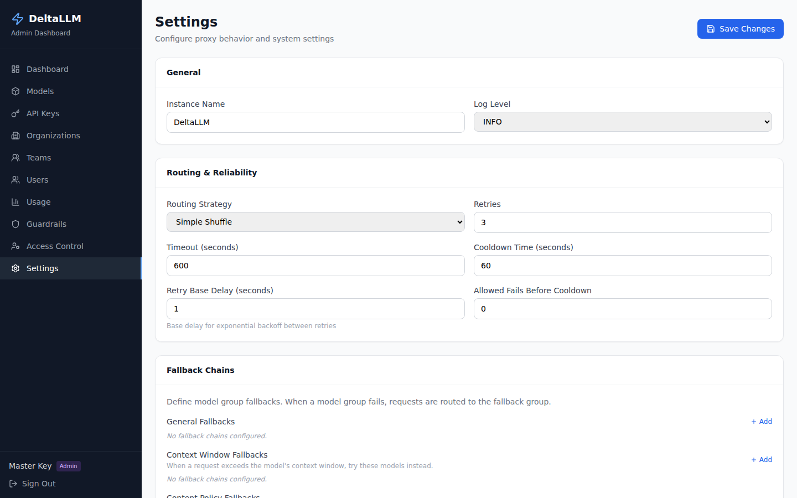

# Settings

Settings control the global runtime behavior of the gateway.

**Access:** platform admin or master-key break-glass session. Changes are installation-wide. See
[Access requirements](access-requirements.md), the [settings API](../api/admin.md#settings-and-routing-config),
and [General Settings](../configuration/general.md).

## Main sections

- **General**: runtime log level
- **Theme**: instance name, simple and expanded logos, favicon, primary and secondary action colors, and menu hover color
- **Routing & Reliability**: default strategy, retries, timeouts, and cooldowns
- **Fallback Chains**: explicit fallback mappings
- **Recent Fallback Events**: operational fallback review
- **Caching**: cache enablement, backend, and TTL
- **Health Checks**: background probe behavior
- **Single sign-on**: identity provider summary, SSO group sync, mappings from claim values to teams and organizations, and a sign-in preview

## When to use this page

Use Settings for platform-wide defaults. Do not use it for per-group routing behavior; that belongs in [Route Groups](route-groups.md).

The Theme tab is available only to platform administrators. Preview changes before saving them.
**Discard changes** restores the last saved values in the form.

**Reset to DeltaLLM defaults** changes the name and colors back to their original values and
permanently removes uploaded logos and the favicon. This cannot be undone from the Settings page.
See [General Settings](../configuration/general.md#ui-branding) for supported file types, storage,
and multi-instance behavior.

The Single sign-on tab is available only to platform administrators, and only when SSO is configured (`enable_sso: true` with a working provider configuration). When SSO is off, the tab does not show. It has its own **Save changes** button. The identity provider connection is read only here. Group sync settings save to the database and apply to all replicas without a restart. Turning on removal asks for confirmation. See [Map SSO groups to roles and teams](../features/authentication.md#map-sso-groups-to-roles-and-teams).

Other authentication and onboarding controls such as the SSO connection, invitations, and self-registration sandbox defaults are configured in `general_settings`, not from this page. See [General Settings](../configuration/general.md#self-registration-settings) and [Authentication & SSO](../features/authentication.md#self-service-sandbox-registration) for the self-registration sandbox flow.

## Good operating pattern

- Keep global defaults conservative
- Use route groups for workload-specific routing
- Use this page only for shared runtime behavior that should apply across the gateway
