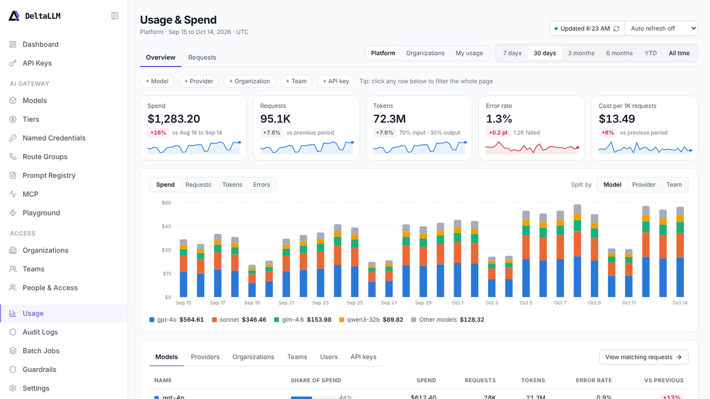
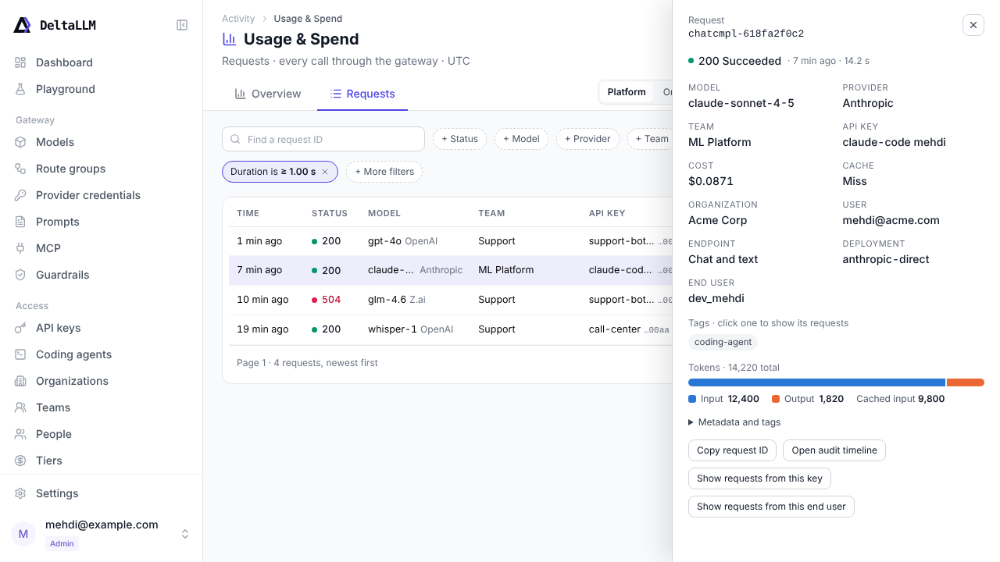

# Usage & Spend

Usage & Spend shows requests, tokens, and cost for a period that you select. It has two views: **Overview** and **Requests**.

**Access:** platform admin or an enabled spend-read permission. The server selects platform,
organization, team, or self scope before returning data. See [Access requirements](access-requirements.md),
the [Spend API](../api/admin.md#spend), and [Budgets and Spend](../features/budgets.md).

## Overview

The Overview shows usage for one period. Use the period control at the top right to select the period.

- **Presets**: 7 days, 30 days, 3 months, 6 months, year to date, and all time. Each one ends today.
- **Custom**: opens a menu with the calendar ranges **Today**, **Yesterday**, **This month**, and **Last month**,
  and a start date and an end date for any other range. Click **Apply range** to use the dates.
  The button then shows the selected range, for example "Last month" or "Sep 1 – Sep 15, 2026".
- On a narrow screen the period control is a list with the same choices.
- Dates are whole days in UTC, and both the start and the end day are included. The end date cannot be in the future.
- The chart uses daily bars up to 45 days, weekly bars up to about 7 months, and monthly bars for longer ranges.

- **Filter bar**: filter by model, provider, organization, team, or API key. Each dimension has one filter.
  Click a row in the top table to add a filter. Click **x** on a filter chip to remove it.
- **Tiles**: spend, requests, tokens, error rate, and cost per 1,000 requests.
  Each tile compares the period with the period of the same length before it.
- **Usage over time**: a stacked bar chart. Select the metric (spend, requests, tokens, or errors)
  and split the bars by model, provider, or team. The chart shows the top 4 groups and "Other".
- **Top table**: the top models, providers, organizations, teams, users, or API keys for the period, with
  the share of spend, spend, requests, tokens, and error rate. Use the pager and the search box to find a row.
- **View matching requests**: opens the Requests view with the same filters.

### Users

The **Users** dimension shows spend for each person who owns the API key. DeltaLLM finds the person in this order:

1. The platform account that owns the key. Keys that an administrator creates for a person use this owner.
2. The runtime user of the key, if the key has no owner account. Older keys and keys from the API can use this.
3. The service account that owns the key. The row shows the service account name and "(service account)".

Requests that match none of these show as **No user**. The service account comes from the key's current owner, because spend events do not store it.

The row shows the account email when your role can see user details. Otherwise it shows the ID. Click a row to filter the page and the Requests view to that person. The **User** field in the request panel uses the same person.

The filters, the period, the metric, the split, and the tab are in the page URL. You can share a link to a filtered view.

## Export

Click **Export** at the top right to download what the current view shows. The export uses the same scope,
period, and filters as the page.

- On the Overview, the export lists every row of the selected top-table tab (for example every team),
  not only the rows on the current page:
  - **Spend by team as CSV** or **as JSON**: one row for each team, with spend, requests, failed requests, and tokens.
  - **Daily spend by team as CSV**: one row for each UTC day and team. Use it for chargeback spreadsheets.
- On Requests, **Requests as CSV** or **as JSONL** downloads the matching requests in the selected window, newest first.
  The file has the table columns, the IDs, and the names. It never contains prompts, responses, or request metadata.

An export has at most 10,000 rows. To get more rows, use a shorter period or the
[export API](../api/admin.md#usage-export), which accepts up to 50,000 rows and a cursor.
Each export writes an audit event (**Usage report exported** or **Request logs exported**).

## Requests

The Requests view shows each request through the gateway, newest first.
It shows only to accounts that can see request logs (platform and organization reporting views).

- Select a time window: 1 hour, 24 hours, 7 days, or 30 days. Or select **Custom** and enter a start
  and an end date and time in UTC. The end is not included. Leave the end empty to show requests up to now.
  If the start is empty or not before the end, the view shows the last 24 hours and says so.
- **View matching requests** on the Overview opens this view with the same filters. A calendar or custom period
  opens as a custom window with the same days. A period longer than 7 days without fixed dates opens the last 30 days.
- Filter by status (success or error), cache (hit or miss), model, provider, team, or API key.
- Filter by **Endpoint** (chat and text, embeddings, images, speech, transcription, rerank, MCP tool) or **Tag**.
  **More filters** adds end user, deployment, HTTP status, error type, a minimum cost, or a minimum duration.
  A filter menu suggests the values in the rows on screen; you can also type a value.
- **Sort** shows the newest requests first, the most expensive first (**Cost**), or the slowest first (**Duration**).
  Cost and Duration read every matching request in the window, so they are available for windows of 31 days or less.
- Type a full request ID in **Find a request ID** to find one request in the selected window.
- Click the columns button at the right of the table header to add columns: Person (the key owner), Organization,
  Endpoint, Deployment, End user, Tags, Error type, Cached tokens, and Request ID. The choice is saved in this browser.
  The extra columns show on wide screens. Each one makes the table wider, and the table then scrolls sideways.
- **Duration** shows milliseconds below 1 second (`412 ms`). Above 1 second it shows seconds
  (`1.26 s`, `15.3 s`), then minutes (`2m 5s`) and hours (`1h 4m`). In this table, durations over
  5 seconds are red. Audit logs, Playground latency, and MCP latency show durations in the same format.
- Click a row to open the request panel. The panel shows the error, the model, the provider, the team,
  the API key, the endpoint, the deployment, the end user, the error type, the tags, the cost, the token counts,
  the metadata, and links to the audit log and to the other requests of the key or the end user. Click a tag to show its requests.
- On a narrow screen, the table hides columns in this order: Team, Cache, and Tokens first, then
  API key and Duration. Long names end with "…". The request panel shows all values.

## Loading and refresh

Each part of the page loads by itself and shows a skeleton until its data is ready.
The page loads a part only when it shows. A hidden tab or a closed filter menu does not send a request.
When you change the chart metric, the page does not load data again.

Click the refresh button to load the latest data. Use the menu next to it to refresh automatically each minute or each 5 minutes.
Automatic refresh stops while the browser tab is hidden.

## Database load

The gateway serves traffic and reports from the same database. The reports have these limits so that they do not
make requests through the gateway slower:

- The browser runs at most two report requests at the same time and keeps recent results for up to one minute.
- The gateway keeps report results in its reporting cache. Users who open the same report share one database read.
  The Refresh button asks for new data. Automatic refresh uses the cache.
- Each gateway process runs at most two report queries at the same time, and the cluster runs at most two.
  Each query has a time limit. When the limit is reached, the gateway returns HTTP 503 with `Retry-After`,
  and the panel shows a message with a **Retry** button.
- A search by request ID reads only the selected time window. Use the shortest window that contains the request.
  The other request filters also read only the selected window, newest first, until a page is full.
- Sorting requests by cost or duration reads every matching request in the window. It is limited to 31 days.
- A custom period uses the same reporting cache, cache times, and limits as the presets. The cache time depends
  on the length of the period: a longer period is cached longer.
- An export runs one query with the same limits. It does not use the cache. A very long period can take too long;
  use a shorter period then.

## Access scope

The server filters every summary, trend, and breakdown before it reaches the browser:

- Organization owners, billing users, and auditors see usage for their authorized organizations.
- Team administrators see usage for teams they administer.
- Regular organization and team members see usage generated by API keys owned by their account.
- Platform administrators see platform-wide usage.

Users with more than one reporting role get a **View** selector.
Organization, team, and personal reports remain separate. Totals and rankings describe one scope at a time.
Users with access only to their own records get the **My usage** view.
They can divide their own usage by organization or team, then examine the selected row's model mix.
Detailed request logs, user and API-key dimensions, and tenant-wide rankings require elevated reporting roles.
In the team and self views, the filter bar shows only the dimensions that the view allows.

Self attribution uses the API key's trusted platform-account owner at request time, not caller-provided `user` or `end_user` values. It is also constrained to the account's current organization or team memberships. Shared-key traffic is therefore attributed to the recorded key owner without allowing former tenant members to retain visibility.

Organization and team breakdowns in **My usage** retain this same owner-account predicate. Selecting a row narrows the personal report; it does not expose usage generated by other accounts in that organization or team.

The setting `general_settings.spend_reporting_v2_enabled` controls team and personal reporting. The default is `true`, so regular members see **My usage** after installation. Set it to `false` to hide the team and personal views at once. Organization and platform reporting stay available. If you upgrade several replicas from a release that does not record key owners, set it to `false` before the upgrade, and follow the [scoped usage reporting rollout](../deployment/usage-reporting-v2.md).

## When to use it

Use the Overview for cost review, tenant reporting, and to find the models, teams, or keys that cause traffic.
Use the Requests view to examine failed or slow requests.
For a live view of the last 24 hours, use the [Dashboard](dashboard.md).

## Legacy attribution

New spend events and managed batch jobs snapshot their key owner's account automatically. Legacy rows without an owner snapshot remain unattributed and are intentionally excluded from self-scoped reports. DeltaLLM does not infer historical ownership from the key's current owner because keys may have been rotated, transferred, or deleted.

Unattributed organizations, teams, users, and models are displayed explicitly as unassigned or unspecified. This state is represented separately from the entity identifier, so a legitimate identifier or model named `__unassigned__` remains distinct and can be inspected normally.
