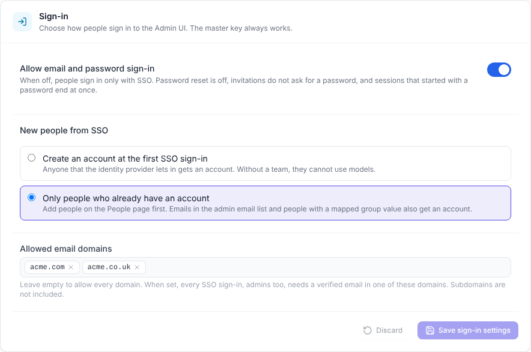
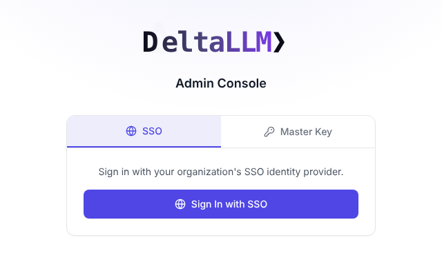
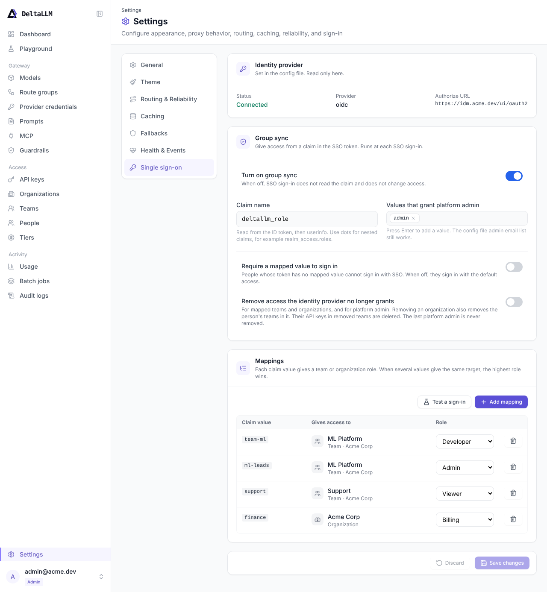
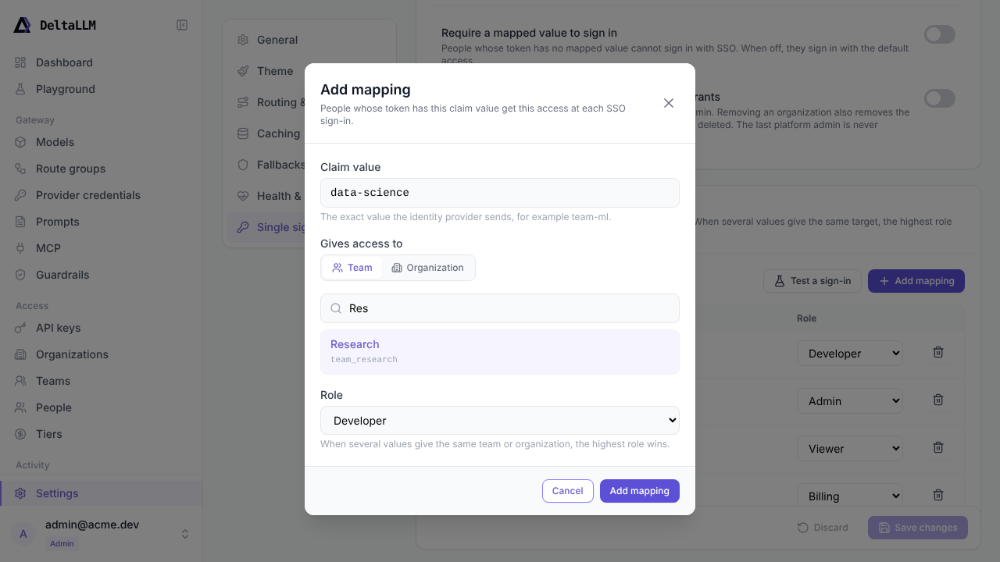
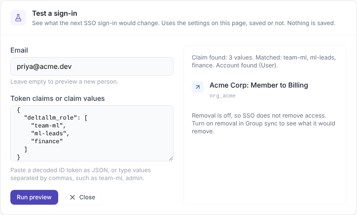

# Authentication & SSO

DeltaLLM supports API authentication, browser-based admin sessions, invitation-based onboarding, password recovery, MFA, SSO, and RBAC.

## Choose the Simplest Working Method

| Need | Start with |
|------|------------|
| Call the proxy API quickly | Master key |
| Give an app limited access | Virtual API key |
| Sign in to the Admin UI | Bootstrap admin account |
| Use company identity | SSO |

## Trusted Console customer sessions

A trusted Console backend can exchange a verified Clerk identity for an opaque, customer-scoped gateway session. Register the existing organization/team binding first. Identity uses the exact issuer and stable subject; email never silently links an existing account. External sign-in is disabled by default and requires the coordinated deployment protocol.

The Console stores gateway sessions in an encrypted backend vault and proxies customer requests under `/gateway/`. Customer sessions retain MFA and password-change controls and have a fixed workspace permission ceiling. Private credentials and models belong to the customer account. Playground inference uses a separately selected, owned API key, with existing billing and inference restrictions.

See [external customer configuration](../configuration/external-customer-auth.md) and the [Console connection contract](../guides/console-gateway-connection.md) for assertion verification, replay protection, renewal, logout, key revocation, and rollout.

## Quick Success Path

1. Set a valid `DELTALLM_MASTER_KEY`
2. Start the gateway
3. Use the master key to make one successful API call
4. Create a scoped virtual API key for real applications
5. Add session login, MFA, or SSO only when you need them

## Master Key

The master key is the fastest way to get started. It has full access to proxy and admin endpoints.

```yaml
general_settings:
  master_key: os.environ/DELTALLM_MASTER_KEY
```

```bash
curl http://localhost:8000/v1/chat/completions \
  -H "Authorization: Bearer YOUR_MASTER_KEY" \
  -H "Content-Type: application/json" \
  -d '{"model": "gpt-4o-mini", "messages": [{"role": "user", "content": "Hello"}]}'
```

## Virtual API Keys

Virtual keys are the right choice for applications because they can be scoped and limited.

```bash
curl -X POST http://localhost:8000/ui/api/keys \
  -H "Authorization: Bearer YOUR_MASTER_KEY" \
  -H "Content-Type: application/json" \
  -d '{
    "key_name": "production-app",
    "team_id": "team-production",
    "max_budget": 50.00
  }'
```

Virtual keys can include:

- spend limits
- RPM and TPM limits
- team or organization ownership

Runtime model and route-group access is governed separately through callable-target bindings and scope policies. Keys no longer carry model allowlists on the key record.

### Rotation and Revocation

DeltaLLM stores virtual keys hashed in the database and caches auth lookups in Redis.

- regenerate replaces the current key and invalidates the old cache entry
- revoke removes the key and invalidates that cache entry
- delete removes the key record and invalidates that cache entry

## Session-Based Login for the Admin UI

The Admin UI uses a secure `deltallm_session` cookie.

To create the first admin account, set:

```yaml
general_settings:
  platform_bootstrap_admin_email: admin@example.com
  platform_bootstrap_admin_password: os.environ/ADMIN_PASSWORD
```

That bootstrap account is created automatically on first startup when both values are present.

### Login Endpoint

```text
POST /auth/internal/login
```

The login response sets the session cookie used by the UI.

### Session Lifetime and Idle Timeout

A browser session ends at whichever limit comes first:

- **Idle timeout**: after `auth_session_idle_timeout_minutes` (default `60`) with no activity. Every request you make renews it, so an active user is not interrupted. Set it to `0` to turn the idle timeout off.
- **Hard cap**: `auth_session_ttl_hours` (default `12`) after sign-in, however active the session is.

Master-key sign-ins use the same idle timeout. Their hard cap is `auth_master_session_ttl_hours` when set, otherwise `auth_session_ttl_hours`.

```yaml
general_settings:
  auth_session_idle_timeout_minutes: 60
  auth_session_ttl_hours: 12
  auth_master_session_ttl_hours: 4
```

Recommended values for an admin console: an idle timeout of 30 to 60 minutes, a hard cap of 12 to 24 hours, and 1 to 4 hours for master-key sign-ins.

How the Admin UI behaves:

- Two minutes before an idle session ends, the UI asks **Are you still there?** with a **Stay signed in** button. If you used the keyboard or mouse in the tab during the last few minutes, the session renews without asking.
- When a session ends, the UI sends you to the login page with the reason (inactivity, time limit, or ended elsewhere), then back to the page you were on after you sign in.
- Returning to a tab whose session already ended goes straight to the login page.
- Background requests, such as auto-refresh on the Usage page, send `X-DeltaLLM-Background: 1` and do not count as activity, so an unattended tab still signs out.

Activity is recorded at most once a minute per session, so the idle timeout can end up to a minute early. Trusted Console customer sessions are not affected; the Console keeps refreshing them.

### Password Change

```text
POST /auth/internal/change-password
```

Use this when an account is marked to change its password after first login.

## Invitations and Password Recovery

DeltaLLM now supports email-first account lifecycle flows:

- invite a user by email from **People**
- let new users activate their account from an invite link
- let existing users reset their password from the login page

### Invitations

Invitation acceptance uses a single-use token and applies organization and team access only when the invite is accepted.

```text
GET  /auth/invitations/{token}
POST /auth/invitations/accept
```

Important behavior:

- new accounts without any auth method must set a password during invite acceptance
- SSO-only accounts can accept invites without creating a local password
- accounts with MFA enabled accept the invitation first, then complete a normal login flow

### Password Recovery

```text
POST /auth/internal/forgot-password
GET  /auth/internal/reset-password/{token}
POST /auth/internal/reset-password
```

The forgot-password flow is intentionally non-enumerating: the API returns the same success response whether the account exists or not.

!!! note
    Invitation and reset emails require `general_settings.email_base_url` to be set to an absolute `http://` or `https://` URL. DeltaLLM now refuses to enable email delivery without it.

## Multi-Factor Authentication

DeltaLLM supports TOTP-based MFA for session logins.

1. `POST /auth/mfa/enroll/start`
2. `POST /auth/mfa/enroll/confirm`
3. Include `mfa_code` during `/auth/internal/login`

### Verified Sessions

For session-authenticated admin access, DeltaLLM distinguishes between:

- a valid browser session
- an MFA-verified browser session

If an account has MFA enabled, admin UI access is blocked until the session completes:

```text
POST /auth/mfa/verify
```

By default, this also applies to SSO-created sessions when the account already has MFA enabled. See [MFA and SSO](#mfa-and-sso) to change this.

### MFA and SSO

The identity provider controls the sign-in strength of an SSO login, for example with passkeys or TOTP. DeltaLLM records how each browser session signed in and uses this value for MFA:

- **Password sessions.** If the account has no MFA, the admin UI shows the MFA enrollment prompt after login. The user can skip it.
- **SSO sessions.** The admin UI does not show the MFA enrollment prompt.

`general_settings.sso_local_mfa` controls the DeltaLLM TOTP step for SSO sessions of accounts that already have MFA enabled:

| Value | SSO login with DeltaLLM MFA enabled |
| --- | --- |
| `optional` (default) | The user must also enter the DeltaLLM TOTP code. |
| `trust_idp` | DeltaLLM trusts the identity provider. The session starts MFA-verified, and DeltaLLM does not ask for its TOTP code. |

```yaml
general_settings:
  sso_local_mfa: trust_idp
```

Set `trust_idp` only when your identity provider enforces the second factor that you require. The setting applies to new SSO logins. Password logins always require the DeltaLLM TOTP code when the account has MFA enabled.

## Single Sign-On

DeltaLLM supports:

- Microsoft Entra
- Google
- Okta
- generic OIDC

### Minimal SSO Configuration

```yaml
general_settings:
  enable_sso: true
  sso_provider: microsoft
  sso_client_id: os.environ/SSO_CLIENT_ID
  sso_client_secret: os.environ/SSO_CLIENT_SECRET
  sso_authorize_url: https://login.microsoftonline.com/{tenant}/oauth2/v2.0/authorize
  sso_token_url: https://login.microsoftonline.com/{tenant}/oauth2/v2.0/token
  sso_userinfo_url: https://graph.microsoft.com/oidc/userinfo
  sso_redirect_uri: https://your-domain.com/auth/callback
```

### How the SSO Flow Works

1. The user starts login from the UI
2. DeltaLLM redirects to the identity provider
3. The provider redirects back to `/auth/callback`
4. DeltaLLM creates or updates the platform account and sets a session cookie

!!! note
    SSO callback state is stored in Redis. If Redis is unavailable, DeltaLLM keeps SSO disabled instead of advertising a broken login flow.

### Restrict Who Can Sign In

By default, DeltaLLM accepts email and password sign-in, and SSO creates an account for each new person that the identity provider lets in. A new account has no team, so it cannot use models. Three settings close these paths. They are off by default and apply to all replicas without a restart.

```yaml
general_settings:
  enable_sso: true
  password_login_enabled: false
  sso_sign_in:
    allow_new_accounts: false
    allowed_email_domains:
      - example.com
```

| Setting | Default | Description |
| --- | --- | --- |
| `password_login_enabled` | `true` | When `false`, people sign in only with SSO. Requires `enable_sso: true`. |
| `sso_sign_in.allow_new_accounts` | `true` | When `false`, SSO signs in only people that already have an account. |
| `sso_sign_in.allowed_email_domains` | `[]` | When set, every SSO sign-in needs a verified email in one of these domains. |

Platform admins can also change these settings in **Settings > Single sign-on > Sign-in**. Saving writes an `ADMIN_SETTINGS_UPDATE` audit event with resource type `sso_sign_in`.



The master key always works. Use it to sign in when the identity provider is down.

#### Turn off password sign-in

When `password_login_enabled` is `false`:

- The login page does not show **Email Login** or **Forgot password?**.
- `POST /auth/internal/login`, `POST /auth/internal/forgot-password`, and the reset-password endpoints return `403`.
- Sessions that started with a password end at once. SSO sessions, master-key sessions, and trusted Console customer sessions continue.
- Invitations do not ask for a password. Accepting an invitation activates the account. Then the person signs in with SSO. The invitation link does not start a session.
- **People > Add person > Create manually** does not ask for a password. The person signs in with SSO with that email.

To prevent a lockout, the Admin UI does not let you turn off password sign-in from a password session, or when SSO is not running. Sign in with SSO first.



#### Close sign-up

When `sso_sign_in.allow_new_accounts` is `false`, SSO signs in a person only when one of these is true:

- The identity provider subject is already linked to an account.
- An account with the same email exists, and the identity provider reports the email as verified. Add people on the **People** page first, or invite them.
- The email is in `sso_admin_email_list`.
- A [group sync](#map-sso-groups-to-roles-and-teams) mapping or admin value matches the token.

All other people get `403` with "No account exists for this email". DeltaLLM does not create an account for them. The check runs in the same database transaction as the sign-in.

`allow_new_accounts: false` cannot be used with `self_registration.enabled: true`, because self-registration creates new accounts.

To admit only people in one identity provider group, also use group sync with `require_mapped_value: true`.

#### Allow only some email domains

When `sso_sign_in.allowed_email_domains` has domains, DeltaLLM checks every SSO sign-in, platform admins too:

- The domain of the email must be in the list. The match is exact, so `example.com` does not include `eu.example.com`. Add each subdomain.
- The identity provider must send `email_verified: true`. Without a verified email, the domain proves nothing.

Other sign-ins get `403` before DeltaLLM reads or changes an account. This check is useful with shared identity providers, such as Google, Microsoft Entra multi-tenant apps, or GitHub, where people from other companies can also sign in.

`self_registration.allowed_domains` is a different list. It selects the people that self-registration puts in the sandbox.

The Admin UI does not let an SSO admin save a list that does not include their own email domain.

### Self-Service Sandbox Registration

With SSO enabled, DeltaLLM can provision new users from approved email domains into a restricted developer sandbox.
This does not permit public signup.
Users must authenticate through the configured identity provider and pass the allowed-domain check.
DeltaLLM puts them in the configured default organization and team.

```yaml
general_settings:
  enable_sso: true
  self_registration:
    enabled: true
    mode: sso_allowed_domain
    allowed_domains:
      - example.com
    require_email_verification: true
    default_org:
      id: org-sandbox
      max_budget: 100
      rpm_limit: 300
    default_team:
      id: team-self-serve
      role: team_developer
      self_service_keys_enabled: true
      self_service_max_keys_per_user: 2
      self_service_budget_ceiling: 5
      self_service_require_expiry: true
      self_service_max_expiry_days: 14
    default_user:
      max_budget: 10
      rpm_limit: 30
```

Provisioning creates or links:

- a platform account with `org_user`
- an organization membership in the default organization
- a team membership in the default team
- a runtime user row with the configured budget and rate limits

The default organization, team, and runtime user values are applied once at provisioning time. Admin edits are not overwritten by config reloads.

### Map SSO Groups to Roles and Teams

Group sync gives DeltaLLM access from a claim in the SSO token. At each SSO sign-in, DeltaLLM reads the claim values and applies the mappings:

- A value in `admin_values` makes the account a platform admin.
- A mapping gives a team role or an organization role.
- A team role also gives membership in the team's organization as `org_member`.
- When several values give the same team or organization, the highest role wins.

Group sync is off by default. Only platform admins can change it. The **Settings > Single sign-on** tab shows only when SSO is configured.



Use **Add mapping** to give a claim value a team role or an organization role:



You can also set group sync in `config.yaml`:

```yaml
general_settings:
  sso_group_sync:
    enabled: true
    claim: deltallm_role
    admin_values: [admin]
    require_mapped_value: false
    remove_unlisted: false
    mappings:
      - value: team-ml
        team_id: team_ml
        team_role: team_developer
      - value: ml-leads
        team_id: team_ml
        team_role: team_admin
      - value: finance
        organization_id: org_acme
        org_role: org_billing
```

| Setting | Default | Description |
| --- | --- | --- |
| `enabled` | `false` | Turns group sync on. |
| `claim` | `groups` | The claim name. Use dots for nested claims, for example `realm_access.roles`. |
| `admin_values` | `[]` | Values that make the account a platform admin. |
| `require_mapped_value` | `false` | When `true`, SSO sign-in is denied with `403` if the token has no mapped value. |
| `remove_unlisted` | `false` | When `true`, SSO removes access that the token no longer gives. See [Removal](#removal). |
| `mappings` | `[]` | Up to 200 mappings. Each mapping has a `value` and one target: `team_id` with `team_role`, or `organization_id` with `org_role`. |

Team roles are `team_admin`, `team_developer`, and `team_viewer`. Organization roles are `org_owner`, `org_admin`, `org_auditor`, `org_billing`, and `org_member`.

#### How DeltaLLM reads the claim

1. DeltaLLM reads the claim from the ID token, then from the userinfo response. The first source that has the claim is used.
2. A JSON list gives one value for each item. A string is split on commas. Spaces stay in the value, so a group can have a name such as `DeltaLLM Admins`.
3. If the token does not have the claim, DeltaLLM does not change access. An empty list means that the person has no values.

DeltaLLM reads the ID token from the token endpoint over TLS. It checks the audience and expiry of the ID token.

Group sync runs in the same database transaction as the sign-in. A person with a mapped value does not go to the self-registration sandbox, also when the mapped team or organization is skipped. Keep mappings current, or the person signs in with no team access.

#### Removal

When `remove_unlisted` is `false`, group sync only adds access and raises roles.

When `remove_unlisted` is `true`, the identity provider controls the mapped scopes:

- DeltaLLM removes team memberships in mapped teams that the token no longer gives.
- DeltaLLM removes organization memberships in mapped organizations that the token no longer gives. Removal also removes the person's memberships in all teams of that organization, mapped or not.
- In a mapped organization, a role higher than the mapped role goes back to the mapped role.
- DeltaLLM removes platform admin when the token has no admin value. An email in `sso_admin_email_list` counts as an admin value.
- DeltaLLM deletes the person's API keys in each removed team, the same as a manual team removal.

Other teams and organizations that have no mapping do not change. DeltaLLM never removes the last active platform admin.

If a creator-owned model still uses a named credential that is shared through a membership, DeltaLLM keeps that membership and the sign-in continues. The SSO sign-in audit event lists it as skipped with the reason `credential_in_use`.

!!! warning
    Group sync runs only at SSO sign-in. To remove access at once when a person leaves, also disable the account on the **People** page.

#### Skipped targets

Group sync skips a mapping when the team or organization does not exist, the organization is not active, or DeltaLLM Cloud manages the team. **Settings > Single sign-on** shows a warning on these rows. You cannot save a mapping to a team or organization that does not exist or that DeltaLLM Cloud manages.

#### Test a sign-in

Use **Test a sign-in** on **Settings > Single sign-on** to see what the next sign-in would change. Enter an email and paste the decoded ID token claims, or values separated by commas. The preview uses the settings on the page, saved or not. It does not change data.



#### Provider examples

**kanidm**: make a claim map for the OAuth2 client. Use the `array` join, or `csv`. Do not use `ssv`, because DeltaLLM does not split values on spaces.

```bash
kanidm system oauth2 update-claim-map deltallm deltallm_role ml_engineers team-ml
kanidm system oauth2 update-claim-map deltallm deltallm_role idm_admins admin
kanidm system oauth2 update-claim-map-join deltallm deltallm_role array
```

**Keycloak**: add a mapper of type "Group Membership" or "User Realm Role" to the client. Use `claim: groups` or `claim: realm_access.roles`.

**Microsoft Entra**: add the `groups` claim to the ID token in the app registration. Entra sends group object IDs, so use the IDs as mapping values.

#### Audit

The SSO sign-in audit event includes a `group_sync` summary of the changes. Saving group sync settings writes an `ADMIN_SETTINGS_UPDATE` event with resource type `sso_group_sync`.

### Auto-Assign Platform Admins

Add emails to `general_settings.sso_admin_email_list` to assign `platform_admin`
when SSO creates a new platform account. Existing accounts keep their stored
platform role, including accounts linking SSO for the first time. This applies
with self-registration enabled or disabled.

The identity provider must report a verified email for the initial platform-admin role grant.
This is also necessary to attach a new provider subject to an existing account.
The ownership check applies to all existing account roles, including when `self_registration.require_email_verification` is `false`.
That setting controls only ordinary new-account provisioning.

An established provider-subject binding can continue signing in without an
email-verification claim. If the provider supplies no subject and DeltaLLM uses
email as its fallback identifier, email verification is required on every login.
Unverified email changes leave the stored account and identity email unchanged;
a verified change is accepted only if another account does not own the address.

Providers that cannot assert verified email ownership receive `403` when first
linking to an existing account. Use an existing local login while configuring
the provider's verified-email assertion. Existing provider-subject bindings
continue to work; DeltaLLM does not provide an authenticated account-linking UI.

Manage subsequent promotions and demotions in **People**. Adding or
removing an email from the list does not change an existing account's role.
To give and remove platform admin from the identity provider at each sign-in,
use `admin_values` in [group sync](#map-sso-groups-to-roles-and-teams).
SSO login also preserves disabled status and rejects inactive accounts; complete
invitation acceptance or reactivate the account through the admin workflow first.

When `sso_default_team_id` applies, SSO creates missing default memberships and
preserves existing organization and team roles. For example, demoting a platform
admin to `org_user` leaves their `org_owner` and `team_admin` memberships intact.
Explicit membership edits and invitation grants can still change those roles.

Older versions assigned roles from this list again on later SSO logins.
Before rollout, verify the first email link with your provider.
The corrected version denies unverified links that older versions accepted.

1. Complete the upgrade across all API replicas.
2. On the **People** page, restore lost platform or membership role changes as necessary.
3. Sign in through SSO again.
4. Verify that the role changes remain.

This change has no database migration. It does not restore roles automatically.
Rollback to an affected version restores the previous role overwrite and unsafe email-linking behavior.

## Role-Based Access Control

DeltaLLM separates platform roles, organization roles, and team roles.

### Platform Roles

| Role | Meaning |
|------|---------|
| `platform_admin` | Full platform access |
| `org_user` | Access limited to assigned organizations |

### Organization Roles

| Role | Typical access |
|------|----------------|
| `org_owner` | Full organization control |
| `org_admin` | Manage teams, users, and keys; view usage from owned keys |
| `org_billing` | Spend-focused visibility |
| `org_auditor` | Read-only operational visibility |
| `org_member` | Basic organization membership; view usage from owned keys |

### Team Roles

| Role | Typical access |
|------|----------------|
| `team_admin` | Manage the team and its keys; view team usage |
| `team_developer` | Use and create keys, self-service key creation (`key.create_self`), view usage from owned keys |
| `team_viewer` | Read-only access, including usage from owned keys |

The `team_developer` role includes `key.create_self`.
When the team enables self-service, this permission lets developers create, regenerate, revoke, and delete their own API keys.
See [API Keys: Self-Service](../admin-ui/api-keys.md#self-service-key-creation).

Personal usage uses an immutable snapshot of the API key owner at request time.
A later key transfer does not move earlier synchronous or batch usage to the new owner.
An intentionally ownerless key remains unattributed. The system does not substitute its current owner.

### Important Note on `user_role`

`deltallm_usertable.user_role` is metadata for user profile types in the UI. It is not the main authorization source of truth.

## Related Pages

- [Admin UI](../admin-ui/index.md)
- [API Reference](../api/index.md)
- [Rate Limiting](rate-limiting.md)
